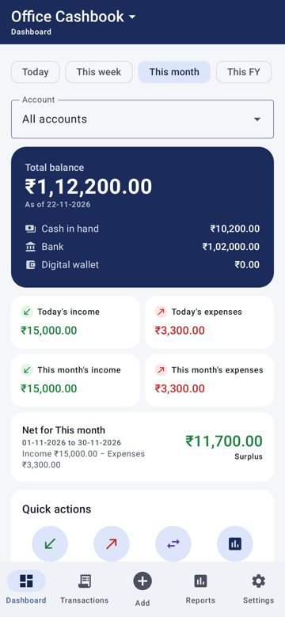
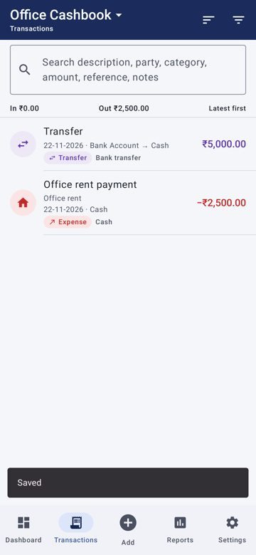

# Cashbook — Android app

An offline-first Android cashbook for recording daily income, expenses, cash / bank / digital-wallet
balances and transfers — for individuals, shopkeepers, freelancers, accountants and small businesses.
Indian Rupee (₹1,25,000.00 grouping), DD-MM-YYYY dates, Indian financial year (1 April – 31 March),
English and Hindi.

| | |
|---|---|
| Package | `com.cashbook.app` (debug build: `com.cashbook.app.debug`, installs side by side) |
| Minimum Android | **8.0 (API 26)** |
| Target / compile SDK | **Android 16 (API 36)** |
| Language / UI | Kotlin 2.2, Jetpack Compose (Material 3) |
| Architecture | MVVM + repository; pure-Kotlin `:core` module for all money/ledger/report logic |
| Storage | Room on **SQLCipher** (encrypted), key wrapped by the Android Keystore; settings in DataStore |
| Background | WorkManager (recycle-bin retention, optional backup reminder) |
| Files | Storage Access Framework, Photo Picker, camera intent (no storage/camera permissions) |
| Reports | On-screen preview, A4 **PDF** (Android `PdfDocument`), editable **.xlsx** (built-in writer) |
| Security | PIN (PBKDF2), biometric unlock (AndroidX Biometric), auto-lock, encrypted backups (AES-256-GCM) |

<p>





</p>

*(Screenshots are rendered by the automated UI tests — see [Testing](#testing).)*

---

## 1. Install the test APK

`dist/Cashbook-1.0.0-test.apk` is a ready-to-install release build (minified, signed with the
**test key** committed in `app/cashbook-test.keystore`). SHA-256 is in the `.sha256` file next to it.

1. Copy the APK to the phone (USB, email, Drive…) or run `adb install dist/Cashbook-1.0.0-test.apk`.
2. On the phone, allow *Install unknown apps* for the app you open it with.
3. Open **Cashbook** and follow the 7-step setup.

> The test key is public. Before publishing on Google Play, create your own upload key and replace
> the `test` signing config in `app/build.gradle.kts`. Data is not transferable between the
> test-signed build and a differently-signed build except through **Backup & restore**.

## 2. Build from source

Requirements: JDK 17+ (21 recommended), Android SDK with platform 36 and build-tools 36
(Android Studio Narwhal or newer installs these automatically).

```bash
cd android
echo "sdk.dir=/path/to/Android/sdk" > local.properties   # Android Studio does this for you
./gradlew test                      # all JVM tests (core + Robolectric app/UI tests)
./gradlew :app:assembleDebug        # app/build/outputs/apk/debug/app-debug.apk
./gradlew :app:assembleRelease      # app/build/outputs/apk/release/app-release.apk (test-signed)
./gradlew :app:installDebug         # install on a connected phone/emulator
```

Open the `android/` folder in Android Studio to run and debug. GitHub Actions
(`.github/workflows/android.yml`) runs the tests and uploads both APKs, the test reports and the
UI screenshots as build artifacts on every push that touches `android/`.

## 3. Project structure

```
android/
├── core/                         Pure Kotlin/JVM — no Android dependency, fully unit-tested
│   └── com/cashbook/core/
│       ├── Money.kt              Paise (Long) parsing/validation, Indian formatting, percentages
│       ├── Dates.kt              Date formats, Indian financial year, period presets
│       ├── Model.kt              Cashbook, Account, Category, Party, Txn (one row per transfer)
│       ├── Ledger.kt             THE balance rules: effects, balances, totals, running balance, negative check
│       ├── Filter.kt             Search, filters, sorting
│       ├── ReportModel.kt / ReportEngine.kt   All 10 reports → one ReportDocument model
│       ├── Xlsx.kt               Dependency-free .xlsx writer (numeric cells, Indian number format)
│       └── backup/               Backup DTOs, streaming AES-GCM encryption, archive codec + validation
└── app/                          Android app
    └── com/cashbook/app/
        ├── CashbookApp.kt        Application + manual DI container (opens the encrypted DB)
        ├── MainActivity.kt       Single activity, lock-on-background, FLAG_SECURE option
        ├── data/                 Room entities/DAOs, LedgerRepository, SettingsRepository,
        │                         SecureStore (Keystore), AttachmentStore, BackupManager, defaults
        ├── export/               PdfReportWriter (A4, repeated headers, page x of y), Exporter (save/share)
        ├── work/                 DailyWorker (retention + backup reminder)
        └── ui/                   Compose screens: onboarding, lock, dashboard, transactions (list,
                                  form, detail, filters), reports, settings, backup, recycle bin,
                                  management (cashbooks, accounts, categories, parties), theme
```

Business calculations never live in UI code: every screen, report and export calls `Ledger` /
`ReportEngine` in `:core`, so the dashboard, transaction list, PDF and Excel always agree.

## 4. Data model

| Entity (table) | Key fields |
|---|---|
| Cashbook (`cashbooks`) | name, description, opening date, currency, created/updated, archived, is_sample |
| Account (`accounts`) | cashbook, name, type (CASH/BANK/WALLET/OTHER), opening balance (paise), opening date, bank name, last 4 digits, description, archived |
| Category (`categories`) | kind (INCOME/EXPENSE), name, parent (sub-category), icon, archived |
| Party (`parties`) | name, type, mobile, email, address, GSTIN, notes, archived |
| Transaction (`transactions`) | cashbook, type (INCOME/EXPENSE/TRANSFER), date, amount (paise), account, **to_account (transfers)**, category, party, payment mode, description, reference, notes, tags, created/updated, **deleted_at (recycle bin)** |
| Attachment (`attachments`) | transaction, file name, MIME type, size, private stored file name |
| BackupHistory (`backup_history`) | time, backup/restore, file name, attachments included, size, success |
| UserSettings | Jetpack DataStore (language, theme, date format, defaults, week start, negative-balance policy, lock, reminders, retention…) — PIN hash and DB key live in the encrypted `SecureStore` |

* **Transfers are one row** (source `account_id`, destination `to_account_id`). Editing, deleting or
  restoring a transfer therefore always moves both sides together; the "Transfer" entity of the
  specification is this row type.
* Foreign keys: deleting a cashbook cascades to its accounts, entries and attachments (only after the
  confirmation that shows the counts). Categories and parties are `RESTRICT`: they can only be deleted
  when unused (categories may be reassigned first); otherwise they are archived. Renaming keeps the id,
  so history shows the new name. Accounts with entries cannot be deleted — only archived.
* The Room schema is exported to `app/schemas/` for future migrations.

## 5. Calculation rules

* Money is stored as **integer paise** (`Long`); parsing uses `BigDecimal` with exactly 0–2 decimals.
  No floating point is ever used for money.
* `Closing = Opening + Income − Expenses + Transfers received − Transfers sent` per account.
* An account's opening balance takes effect **on its opening date**; entries cannot be dated before it.
* A report's opening balance = everything before the period start (opening balances + entries);
  accounts opened inside the period show their opening balance as a separate line.
* Transfers are never income or expense. For a set of accounts, a transfer between two accounts of the
  set nets to zero; a transfer leaving the set counts as *transfer out*.
* Entries on the same date are ordered by creation time, then id.
* Saving an entry that would push any affected account below zero **at any point from that date on**
  shows a warning (“Save anyway”) — or is blocked if *Allow negative balances* is off in Settings.
* Balances are derived, never stored, so add / edit / delete / restore always recalculate. The UI
  snapshot re-reads all tables inside **one database transaction** after every change, so screens
  never see a half-updated state.

## 6. Feature checklist (spec → implementation)

| Area | Where |
|---|---|
| First-run setup (welcome, language, theme, cashbook, accounts + opening balances, optional PIN, optional sample data; skippable steps) | `ui/onboarding` |
| Multiple cashbooks: create, edit, switch, default, archive/restore, export, delete with impact counts + type-name confirmation, combined view | `ui/manage/CashbookScreens.kt`, cashbook switcher in the title bar |
| Accounts: types, opening balance/date, bank name, last 4 digits only, archive, balance "as of" date, account vs payment mode explained | `ui/manage/AccountScreens.kt` |
| Dashboard: today / month totals, net for selected period, total + cash/bank/wallet, quick actions, 6/12-month chart, top expense categories, account balances, recent entries, backup status; filters: cashbook, account, today/week/month/FY/custom | `ui/dashboard` |
| Income / Expense / Transfer forms with all fields, inline category/party creation, attachments, *Save and add another*, draft survives process death | `ui/transactions/TransactionForm*` |
| Transaction history: search (description, party, category, amount, reference, notes, tags), all filters, 4 sort orders, running balance for one account, filtered banner + Clear filters, detail / edit / duplicate / delete / share | `ui/transactions` |
| Categories with sub-categories and icons, archive, rename, delete-with-reassign | `ui/manage/CategoryScreens.kt` |
| Parties: types, mobile, email, address, GSTIN, search, linked entries, party-wise export, archive | `ui/manage/PartyScreens.kt` |
| 10 reports (daily, monthly, yearly, FY, category, party, account, income & expense, transfers, custom) with header, filters, opening/closing balances and cash-basis notes | `core/ReportEngine.kt`, `ui/reports` |
| PDF (A4, repeated table headings, page x of y, aligned amounts, landscape for wide tables) and Excel (summary sheet, one sheet per table, standard *Transactions* sheet, numeric cells) — save via file picker or share | `export/`, `core/Xlsx.kt` |
| Attachments: camera, gallery (photo picker), file picker; JPG/PNG/PDF; preview (incl. PDF first page), size, replace, remove, open in viewer; 10 MB limit, large photos downscaled | `data/AttachmentStore.kt`, `ui/components/Attachments.kt` |
| Encrypted backup to any SAF location (device, SD, cloud drive), attachments optional, last-backup time, history, reminders; restore with full validation, summary, replace warning + confirmation, atomic restore that preserves data on failure | `data/BackupManager.kt`, `core/backup`, `ui/settings/BackupScreen.kt` |
| PIN lock, biometric, auto-lock timeout, brute-force delay, hide-in-recents/screenshot blocking, privacy policy | `ui/lock`, `ui/settings/SecuritySettingsScreen.kt` |
| Recycle bin: restore, delete permanently, empty, deletion date, retention (off/30/90 days) | `ui/settings/RecycleBinScreen.kt`, `work/` |
| Settings: language, date format, theme, default cashbook/account, week start, currency display, negative balances, security, data, guide, privacy, about, version, feedback | `ui/settings` |
| Sample data (Office Cashbook) — add / remove any time | Settings › Data |

## 7. Security & privacy

* **No `INTERNET` permission.** Requested permissions: notifications (only for backup reminders,
  asked at runtime) and biometrics. WorkManager adds wake-lock/boot-completed for its scheduler.
* Database: SQLCipher with a random 256-bit key; the key is stored in `SecureStore`, a file encrypted
  with a non-exportable AES-GCM key in the **Android Keystore**.
* PIN: PBKDF2-HMAC-SHA256 (60 000 iterations, random salt), 30-second lock-out after 5 wrong tries.
* Android auto-backup is disabled (the Keystore key cannot move devices); use the app's backup.
* Backup file (`.cbk`): `"CBKP"` header, PBKDF2-HMAC-SHA256 (150 000 iterations) → AES-256-GCM in
  64 KiB authenticated chunks (detects wrong password, tampering, reordering and truncation). Inside:
  a zip with `manifest.json`, `data.json` and `attachments/`. **A lost password cannot be recovered.**
* Never asks for bank passwords, UPI/card PINs, OTPs or net-banking credentials; no bank integration.

## 8. Testing

```bash
./gradlew test
```

57 automated tests, all passing:

| Suite | What it checks |
|---|---|
| `core` `MoneyTest`, `DatesTest` | Parsing rejects empty/zero/negative/3-decimal/non-numeric/huge amounts; Indian grouping; FY boundaries; period presets; DD-MM-YYYY |
| `core` `LedgerTest` | Spec sample: Office Cash **₹13,500**, SBI **₹59,000**, total **₹72,500**; income/expense effects; transfer keeps total and is excluded from income/expense; edit/delete recalculation; report opening balances; same-date ordering; negative-balance detection incl. back-dated entries and edits |
| `core` `ReportEngineTest`, `FilterTest`, `XlsxTest` | Report totals match entries; opening/closing; daily running balance; category %; transfers excluded from I&E; custom filters; FY month breakdown; search/filter/sort; .xlsx structure, numeric amounts and real date cells |
| `core` `BackupCodecTest` | Encrypted round trip (multi-chunk attachment); wrong password; damaged, truncated and foreign files rejected; weak password refused; referential validation |
| `app` `RepositoryTest` (Robolectric + real Room schema) | Sample balances; add/edit/delete/restore; transfer delete/restore moves both sides; category rename/reassign/delete rules; party and account delete protection; archive keeps history; cashbook delete impact + cascade; sample removal keeps user data; recycle-bin purge removes files |
| `app` `BackupRestoreTest` | Backup → wipe → restore reproduces data and attachment bytes; restore without attachments; wrong password / damaged / truncated / non-backup files fail **and current data is untouched** |
| `app` `UiFlowTest` (Robolectric + Compose) | Full first-run setup through the UI, adding an expense and a transfer through the real forms (balances verified), validation messages, and screenshots in light, dark, Hindi and a small 360 dp phone (`app/build/screenshots/`) |

Not automated here (please check on a device): camera capture, biometric prompt, Android share sheet,
opening the generated PDF in a viewer, notifications, and choosing a cloud drive in the file picker.

## 9. Known limitations / next phases

* Records **cash movements**; it is not an invoicing, receivables/payables or GST-filing system.
  Party reports show money received/paid, not outstanding balances.
* Combined (all-cashbooks) view sums balances; reports for a combined view use all active cashbooks.
* Backups are manual or reminder-based; there is no automatic cloud sync.
* Suggested next phases: recurring entries, budgets, invoice & outstanding tracking, multi-currency
  conversion, home-screen widget, automatic scheduled backups to a chosen folder, Play Store release
  signing and an instrumented test pass on physical devices.
