# Cashbook — Android app

An offline-first Android cashbook for recording daily income, expenses, cash / bank / digital-wallet
balances and transfers — for individuals, shopkeepers, freelancers, accountants and small businesses.
Indian Rupee (₹1,25,000.00 grouping), DD-MM-YYYY dates, Indian financial year (1 April – 31 March),
English and Hindi.

| | |
|---|---|
| Package | `com.cashbook.app` (debug build: `com.cashbook.app.debug`, installs side by side) |
| Minimum Android | **8.0 (API 26)** |
| Target / compile SDK | **Android 16 (API 36)** |
| Language / UI | Kotlin 2.2, Jetpack Compose (Material 3) |
| Architecture | MVVM + repository; pure-Kotlin `:core` module for all money/ledger/report logic |
| Storage | Room on **SQLCipher** (encrypted), key wrapped by the Android Keystore; settings in DataStore |
| Background | WorkManager (recycle-bin retention, recurring entries, automatic backup, optional alerts) |
| Widget | Home-screen widget (RemoteViews) with quick add and an opt-in balance |
| Files | Storage Access Framework, Photo Picker, camera intent (no storage/camera permissions) |
| Reports | On-screen preview, A4 **PDF** (Android `PdfDocument`), editable **.xlsx** (built-in writer) |
| Security | PIN (PBKDF2), biometric unlock (AndroidX Biometric), auto-lock, encrypted backups (AES-256-GCM) |

<p>

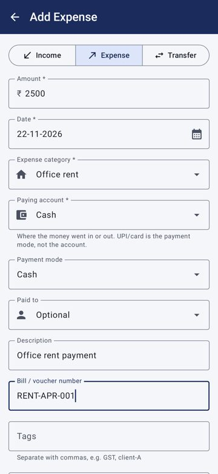


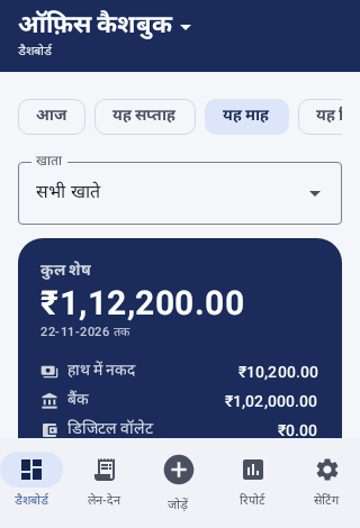
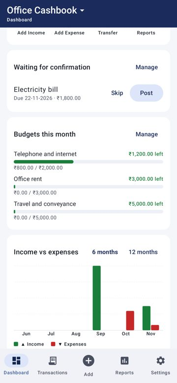
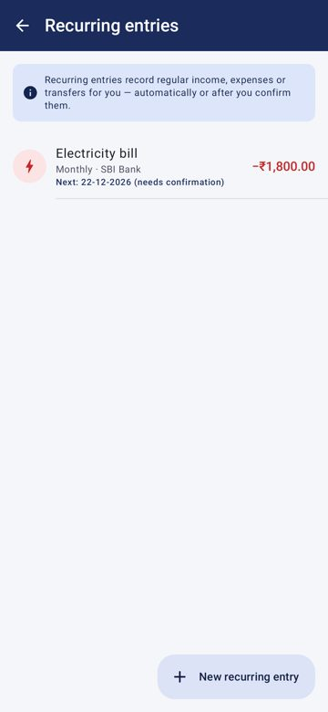
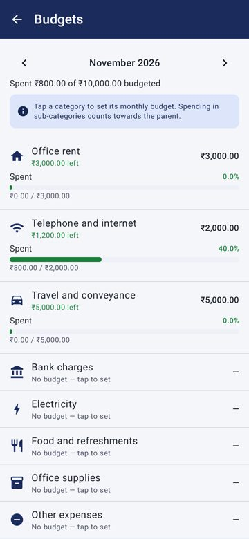
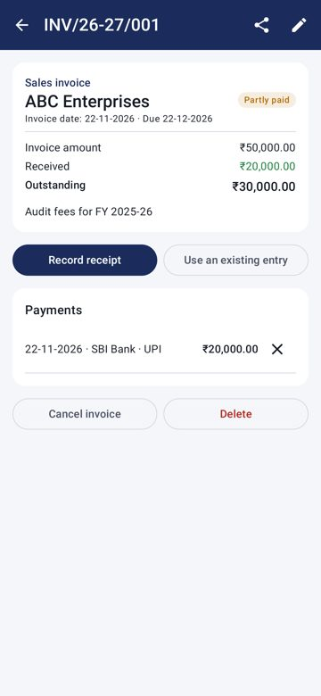

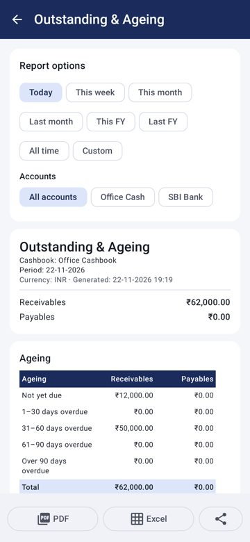

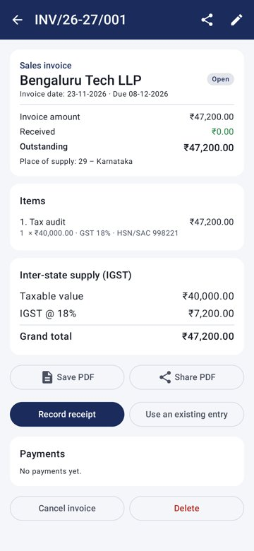
</p>
<p>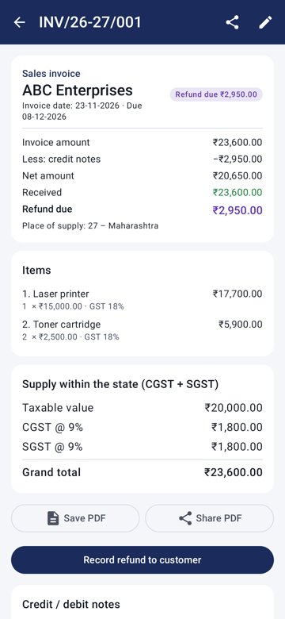 </p>
<p>   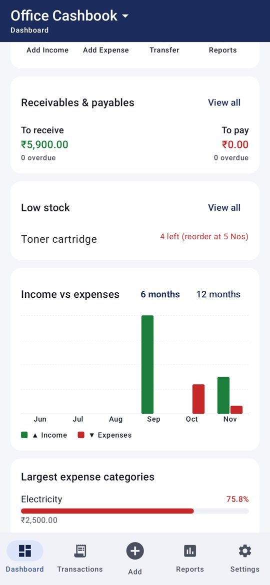</p>
<p> 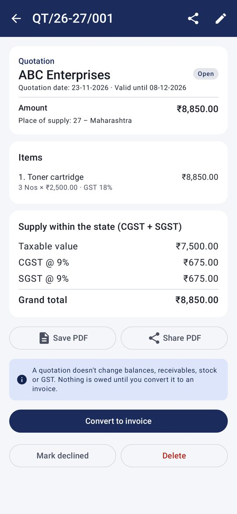  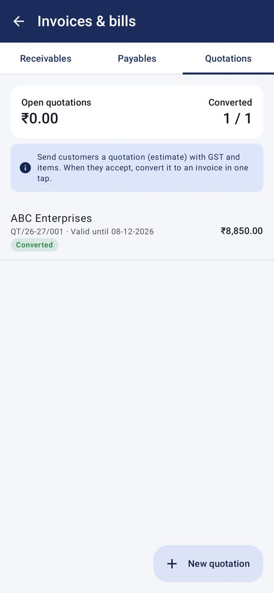</p>
<p>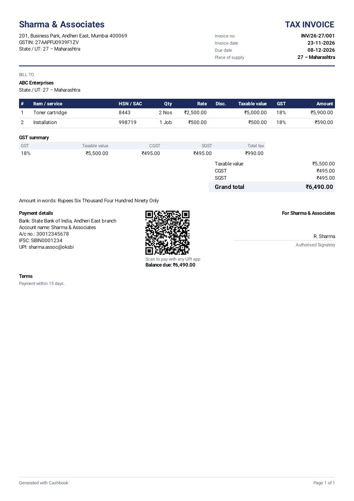</p>
<p>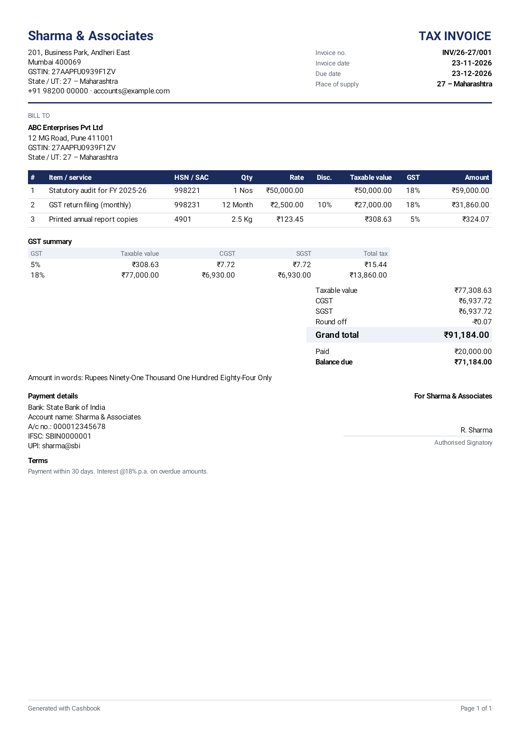 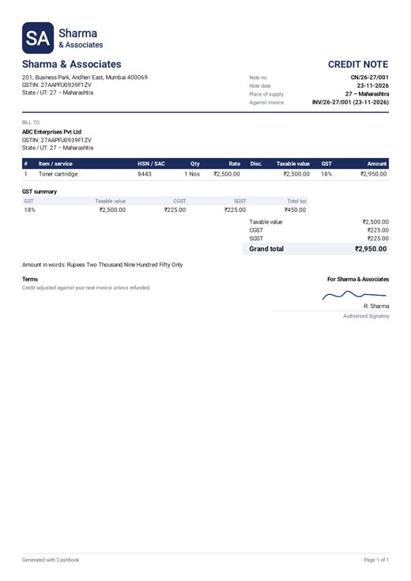</p>

**What's new in 1.6** — **quotations / estimates** (itemised with GST, own PDF, valid-until date) that you
turn into an invoice with one tap, and a **UPI payment QR code** for unpaid sales invoices, in the app and printed
on the invoice PDF (any UPI app opens it with the amount and invoice number filled in).
**1.5** — a **products & services** list (HSN/SAC, unit, sale/purchase rate, GST rate) that you
pick from on invoice lines, **stock on hand** worked out from your sales, purchase bills, credit notes and
adjustments, a **low-stock** dashboard card, and **Stock summary** and **Item-wise sales** reports.
**1.4** — credit and debit notes (itemised with GST, own PDF), refunds when a credit note
follows payment, and your logo and signature on invoices and notes.
**1.3** — business profile, itemised GST invoices (CGST/SGST or IGST by place of supply),
printable tax-invoice PDF, GST summary report and GSTIN check-digit validation.
**1.2** — invoices & bills with outstanding balances and an ageing report, invoice and
budget alerts, and a home-screen widget. **1.1** added recurring entries, budgets, automatic backups and
release signing. See [CHANGELOG.md](CHANGELOG.md).

*(Screenshots are rendered by the automated UI tests — see [Testing](#testing).)*

---

## 1. Install the test APK

`dist/Cashbook-1.6.0-test.apk` is a ready-to-install release build (minified, signed with the
**test key** committed in `app/cashbook-test.keystore`). SHA-256 is in the `.sha256` file next to it.

1. Copy the APK to the phone (USB, email, Drive…) or run `adb install dist/Cashbook-1.6.0-test.apk`.
   Installing it over any earlier version keeps your data (the database upgrades automatically to v7).
2. On the phone, allow *Install unknown apps* for the app you open it with.
3. Open **Cashbook** and follow the 7-step setup.

> The test key is public. To sign with your own key, create one and copy `keystore.properties.example`
> to `keystore.properties` (git-ignored); `assembleRelease` then uses it automatically:
> ```bash
> keytool -genkeypair -v -keystore upload.jks -alias upload -keyalg RSA -keysize 2048 -validity 10000
> cp keystore.properties.example keystore.properties   # then edit the passwords
> ```
> Android only installs an update signed with the same key, so moving from the test-signed build to
> your own key means uninstalling first — take a **backup** before you do, then restore it.

## 2. Build from source

Requirements: JDK 17+ (21 recommended), Android SDK with platform 36 and build-tools 36
(Android Studio Narwhal or newer installs these automatically).

```bash
cd android
echo "sdk.dir=/path/to/Android/sdk" > local.properties   # Android Studio does this for you
./gradlew test                      # all JVM tests (core + Robolectric app/UI tests)
./gradlew :app:assembleDebug        # app/build/outputs/apk/debug/app-debug.apk
./gradlew :app:assembleRelease      # app/build/outputs/apk/release/app-release.apk (test-signed)
./gradlew :app:installDebug         # install on a connected phone/emulator
```

Open the `android/` folder in Android Studio to run and debug. GitHub Actions
(`.github/workflows/android.yml`) runs the tests and uploads both APKs, the test reports and the
UI screenshots as build artifacts on every push that touches `android/`.

## 3. Project structure

```
android/
├── core/                         Pure Kotlin/JVM — no Android dependency, fully unit-tested
│   └── com/cashbook/core/
│       ├── Money.kt              Paise (Long) parsing/validation, Indian formatting, percentages
│       ├── Dates.kt              Date formats, Indian financial year, period presets
│       ├── Model.kt              Cashbook, Account, Category, Party, Txn (one row per transfer)
│       ├── Ledger.kt             THE balance rules: effects, balances, totals, running balance, negative check
│       ├── Filter.kt             Search, filters, sorting
│       ├── ReportModel.kt / ReportEngine.kt   All 10 reports → one ReportDocument model
│       ├── Recurrence.kt         Recurring rules: drift-free schedule, catch-up, end dates
│       ├── Budget.kt             Monthly budgets and progress (sub-categories count to the parent)
│       ├── Invoices.kt           Invoice/bill balances, status, ageing buckets, allocation rules, numbering
│       ├── Catalog.kt            Products/services, stock moves, on-hand, stock value, low stock, item-wise sales
│       ├── Upi.kt                UPI ID check, upi://pay links, QR encoding (ZXing core)
│       ├── Gst.kt                GST rates, state codes, GSTIN check digit, line/tax totals, round-off, amount in words
│       ├── Xlsx.kt               Dependency-free .xlsx writer (numeric cells, Indian number format)
│       └── backup/               Backup DTOs, streaming AES-GCM encryption, archive codec + validation
└── app/                          Android app
    └── com/cashbook/app/
        ├── CashbookApp.kt        Application + manual DI container (opens the encrypted DB)
        ├── MainActivity.kt       Single activity, lock-on-background, FLAG_SECURE option
        ├── data/                 Room entities/DAOs, LedgerRepository, SettingsRepository,
        │                         SecureStore (Keystore), AttachmentStore, BackupManager, defaults
        ├── export/               PdfReportWriter (A4 reports), InvoicePdfWriter (tax invoice), Exporter (save/share)
        ├── work/                 DailyWorker (retention, recurring entries, automatic backup, reminders) + Alerts
        ├── widget/               Home-screen widget (quick add, opt-in balance)
        └── ui/                   Compose screens: onboarding, lock, dashboard, transactions (list,
                                  form, detail, filters), reports, settings, backup, recycle bin,
                                  management (cashbooks, accounts, categories, parties), theme
```

Business calculations never live in UI code: every screen, report and export calls `Ledger` /
`ReportEngine` in `:core`, so the dashboard, transaction list, PDF and Excel always agree.

## 4. Data model

| Entity (table) | Key fields |
|---|---|
| Cashbook (`cashbooks`) | name, description, opening date, currency, created/updated, archived, is_sample |
| Account (`accounts`) | cashbook, name, type (CASH/BANK/WALLET/OTHER), opening balance (paise), opening date, bank name, last 4 digits, description, archived |
| Category (`categories`) | kind (INCOME/EXPENSE), name, parent (sub-category), icon, archived |
| Party (`parties`) | name, type, mobile, email, address, GSTIN, notes, archived |
| Transaction (`transactions`) | cashbook, type (INCOME/EXPENSE/TRANSFER), date, amount (paise), account, **to_account (transfers)**, category, party, payment mode, description, reference, notes, tags, created/updated, **deleted_at (recycle bin)** |
| Attachment (`attachments`) | transaction, file name, MIME type, size, private stored file name |
| Recurring (`recurring`, v2) | cashbook, type, amount, account(s), category, party, mode, description, reference, frequency (daily/weekly/monthly/quarterly/yearly) × interval, start date, optional end date, next occurrence index, auto-post or confirm, active |
| Budget (`budgets`, v2) | cashbook, expense category (unique per cashbook), monthly amount |
| Invoice (`invoices`, v3) | cashbook, kind (SALE = receivable / PURCHASE = payable), **doc type** (INVOICE / CREDIT_NOTE / DEBIT_NOTE, v5; QUOTATION, v7), **ref invoice** (for notes, v5), **converted invoice** (for quotations, v7), number (unique per cashbook + kind + doc type), party, issue date, due date, amount, place of supply, round-off, description, notes, cancelled |
| InvoiceItem (`invoice_items`, v4) | invoice, position, description, HSN/SAC, quantity (thousandths), unit, rate (paise), discount and GST rate (basis points), **catalogue item** (optional, v6) |
| CatalogItem (`catalog_items`, v6) | name (unique, case-insensitive), kind (GOODS/SERVICE), HSN/SAC, unit, sale rate, purchase rate, GST rate, description, opening stock + date, reorder level, archived |
| StockAdjustment (`stock_adjustments`, v6) | item, date, quantity change (thousandths, + or −), reason |
| Allocation (`allocations`, v3) | invoice, payment entry, amount applied (one row per invoice + entry) |
| BackupHistory (`backup_history`) | time, backup/restore, file name, attachments included, size, success |
| UserSettings | Jetpack DataStore (language, theme, date format, defaults, week start, negative-balance policy, lock, reminders, retention…) — PIN hash and DB key live in the encrypted `SecureStore` |

* **Transfers are one row** (source `account_id`, destination `to_account_id`). Editing, deleting or
  restoring a transfer therefore always moves both sides together; the "Transfer" entity of the
  specification is this row type.
* Foreign keys: deleting a cashbook cascades to its accounts, entries and attachments (only after the
  confirmation that shows the counts). Categories and parties are `RESTRICT`: they can only be deleted
  when unused (categories may be reassigned first); otherwise they are archived. Renaming keeps the id,
  so history shows the new name. Accounts with entries cannot be deleted — only archived.
* Transactions created by a schedule carry `recurring_id` (v2) so they can be traced back to it.
* **Invoices and bills never change balances.** A payment is an ordinary income (sale) or expense
  (purchase) entry, linked through `allocations`. Outstanding = invoice amount − allocations whose entry
  is live, so moving a payment to the recycle bin re-opens the invoice and restoring it settles it again.
  An entry can be split across several invoices; it can't be edited below the amount applied.
* The Room schema is exported to `app/schemas/`. **Migrations** live in `data/db/Migrations.kt` and are
  verified by `MigrationTest` against those exported schemas (v1 → v2 adds `recurring`, `budgets` and
  `transactions.recurring_id`; v2 → v3 adds `invoices` and `allocations`; v3 → v4 adds `invoice_items`, `invoices.place_of_supply`, `invoices.round_off`
  and `parties.state_code`, filling party states from existing GSTINs; v4 → v5 adds `invoices.doc_type` and
  `invoices.ref_invoice_id` and widens number uniqueness to include the doc type; v5 → v6 adds `catalog_items`, `stock_adjustments` and
  `invoice_items.item_id`; v6 → v7 adds `invoices.converted_invoice_id` for quotations; existing rows are untouched).
* **Quotations** are rows in `invoices` with `doc_type = QUOTATION` (always SALE, series QT/26-27/001, due date =
  valid until). The snapshot keeps them in a separate list, so balances, receivables, alerts, stock and every report
  ignore them; the GST and item-wise reports also exclude them directly. Status is derived: converted, declined
  (cancelled), expired (past valid-until) or open. Converting copies party, place of supply, items (with their
  catalogue links), description and notes into a new invoice dated today and due in 15 days, and stores its id on the
  quotation; deleting that invoice re-opens the quotation.
* **UPI QR**: for a sales invoice with a balance and a valid UPI ID in the business profile, the app shows and the PDF
  prints a QR code for `upi://pay?pa=…&pn=…&am=<balance>&cu=INR&tn=<invoice no.>` (error correction M).
* **Stock** is never stored, it is derived (`core/Catalog.kt`): opening stock (from its date) + purchase bill
  lines − sale invoice lines + sale credit-note lines − purchase credit-note lines ± adjustments. Debit notes and
  cancelled documents don't move stock. Services have no stock. Stock value uses the purchase rate. Items used on
  invoices or adjustments can only be archived, not deleted; editing an item never changes saved invoices.
* **Credit / debit notes** are rows in `invoices` with `doc_type` and `ref_invoice_id`, so numbering
  (CN/…, DN/…), line items, GST, PDF and backup reuse the invoice code. A note takes the original's cashbook,
  kind, party and place of supply. Net owed = amount + debit notes − credit notes; credit notes can't exceed
  amount + debit notes. Payments minus **refunds** (an entry of the opposite type linked to the invoice) give
  "paid"; when paid exceeds the net amount the invoice is **Refund due**. Invoices with notes can't be cancelled
  or deleted until the notes are removed. In the GST summary, credit notes reduce and debit notes add tax.
* **GST calculation** (`core/Gst.kt`): line taxable = qty × rate − discount, each rounded to the paisa; tax per
  line at the GST rate — CGST and SGST each at half the rate when the place of supply is the seller's state,
  otherwise IGST; optional round-off of the grand total to the nearest rupee. An itemised invoice's amount is
  always this grand total. The business profile (name, GSTIN, state, bank/UPI, terms) is kept in DataStore
  and included in backups.

## 5. Calculation rules

* Money is stored as **integer paise** (`Long`); parsing uses `BigDecimal` with exactly 0–2 decimals.
  No floating point is ever used for money.
* `Closing = Opening + Income − Expenses + Transfers received − Transfers sent` per account.
* An account's opening balance takes effect **on its opening date**; entries cannot be dated before it.
* A report's opening balance = everything before the period start (opening balances + entries);
  accounts opened inside the period show their opening balance as a separate line.
* Transfers are never income or expense. For a set of accounts, a transfer between two accounts of the
  set nets to zero; a transfer leaving the set counts as *transfer out*.
* Entries on the same date are ordered by creation time, then id.
* Saving an entry that would push any affected account below zero **at any point from that date on**
  shows a warning (“Save anyway”) — or is blocked if *Allow negative balances* is off in Settings.
* Balances are derived, never stored, so add / edit / delete / restore always recalculate. The UI
  snapshot re-reads all tables inside **one database transaction** after every change, so screens
  never see a half-updated state.

## 6. Feature checklist (spec → implementation)

| Area | Where |
|---|---|
| First-run setup (welcome, language, theme, cashbook, accounts + opening balances, optional PIN, optional sample data; skippable steps) | `ui/onboarding` |
| Multiple cashbooks: create, edit, switch, default, archive/restore, export, delete with impact counts + type-name confirmation, combined view | `ui/manage/CashbookScreens.kt`, cashbook switcher in the title bar |
| Accounts: types, opening balance/date, bank name, last 4 digits only, archive, balance "as of" date, account vs payment mode explained | `ui/manage/AccountScreens.kt` |
| Dashboard: today / month totals, net for selected period, total + cash/bank/wallet, quick actions, 6/12-month chart, top expense categories, account balances, recent entries, backup status; filters: cashbook, account, today/week/month/FY/custom | `ui/dashboard` |
| Income / Expense / Transfer forms with all fields, inline category/party creation, attachments, *Save and add another*, draft survives process death | `ui/transactions/TransactionForm*` |
| Transaction history: search (description, party, category, amount, reference, notes, tags), all filters, 4 sort orders, running balance for one account, filtered banner + Clear filters, detail / edit / duplicate / delete / share | `ui/transactions` |
| Categories with sub-categories and icons, archive, rename, delete-with-reassign | `ui/manage/CategoryScreens.kt` |
| Parties: types, mobile, email, address, GSTIN, search, linked entries, party-wise export, archive | `ui/manage/PartyScreens.kt` |
| 10 reports (daily, monthly, yearly, FY, category, party, account, income & expense, transfers, custom) with header, filters, opening/closing balances and cash-basis notes | `core/ReportEngine.kt`, `ui/reports` |
| PDF (A4, repeated table headings, page x of y, aligned amounts, landscape for wide tables) and Excel (summary sheet, one sheet per table, standard *Transactions* sheet, numeric cells) — save via file picker or share | `export/`, `core/Xlsx.kt` |
| Attachments: camera, gallery (photo picker), file picker; JPG/PNG/PDF; preview (incl. PDF first page), size, replace, remove, open in viewer; 10 MB limit, large photos downscaled | `data/AttachmentStore.kt`, `ui/components/Attachments.kt` |
| Encrypted backup to any SAF location (device, SD, cloud drive), attachments optional, last-backup time, history, reminders; restore with full validation, summary, replace warning + confirmation, atomic restore that preserves data on failure | `data/BackupManager.kt`, `core/backup`, `ui/settings/BackupScreen.kt` |
| PIN lock, biometric, auto-lock timeout, brute-force delay, hide-in-recents/screenshot blocking, privacy policy | `ui/lock`, `ui/settings/SecuritySettingsScreen.kt` |
| Recycle bin: restore, delete permanently, empty, deletion date, retention (off/30/90 days) | `ui/settings/RecycleBinScreen.kt`, `work/` |
| Settings: language, date format, theme, default cashbook/account, week start, currency display, negative balances, security, data, guide, privacy, about, version, feedback | `ui/settings` |
| Sample data (Office Cashbook) — add / remove any time | Settings › Data |
| **1.1** Recurring entries: daily → yearly with intervals, end date, pause, auto-post or confirm (Post / Skip on the dashboard, amount can vary), "Make recurring" from any entry, catch-up after the app was closed | `core/Recurrence.kt`, `ui/recurring`, `LedgerRepository.postDueRecurring` |
| **1.1** Monthly budgets per expense category with dashboard progress (OK / ≥ 80 % / over) | `core/Budget.kt`, `ui/manage/BudgetsScreen.kt` |
| **1.6** Quotations / estimates: itemised with GST, valid-until date, QUOTATION PDF, open / expired / declined / converted, one-tap conversion to an invoice (items, party and place of supply copied), link back from the invoice | `core/Invoices.kt` (`Quotations`), `ui/invoices/QuotationScreens.kt`, `LedgerRepository.convertQuotation` |
| **1.6** UPI payment QR for unpaid sales invoices, on screen and on the PDF (amount = balance due, note = invoice number); UPI ID validated in the business profile; "Pay by UPI" line in the shared text | `core/Upi.kt`, `export/InvoicePdfWriter.kt`, `UpiQrCard` |
| **1.5** Products & services list with search, low-stock filter, archive; pick an item on an invoice line to fill description, HSN/SAC, unit, rate and GST (stock shown, warning when a sale exceeds it) | `core/Catalog.kt`, `ui/manage/CatalogScreens.kt`, `ui/invoices/InvoiceItemsEditor.kt` |
| **1.5** Stock on hand, stock adjustments with reason, low-stock dashboard card; Stock summary and Item-wise sales reports (PDF/Excel) | `core/Catalog.kt`, `core/ReportEngine.kt`, `ui/dashboard` |
| **1.4** Credit and debit notes (itemised with GST, starting from the invoice's items), refunds, invoice status "Refund due", notes in the GST summary; CREDIT NOTE / DEBIT NOTE PDF referring to the original invoice | `core/Invoices.kt`, `ui/invoices` |
| **1.4** Logo and signature images on invoices and notes (gallery picker, scaled, included in backups) | `AttachmentStore.importBrand`, `BusinessProfileScreen` |
| **1.3** Business profile; itemised invoices/bills with HSN/SAC, qty, unit, rate, discount, GST rate (0, 0.25, 3, 5, 12, 18, 28, 40 %); place of supply; live totals | `ui/settings/BusinessProfileScreen.kt`, `ui/invoices/InvoiceItemsEditor.kt` |
| **1.3** Tax invoice PDF (A4): seller/buyer GSTIN and state, items with repeated headings, GST summary by rate, totals, round-off, paid/balance, amount in words (Indian system), bank/UPI, terms, signatory | `export/InvoicePdfWriter.kt` |
| **1.3** GST Summary report (output vs input tax by rate, CGST/SGST/IGST) and GSTIN check-digit validation with state auto-fill | `ReportEngine.gstSummary()`, `core/Gst.kt` |
| **1.2** Invoices & bills: numbering per financial year (INV/26-27/001, BILL/…), due-date presets, status (open / partly paid / overdue n days / paid / cancelled), record receipt or payment (creates the entry), apply existing entries, unlink, cancel, share; dashboard and party outstanding | `core/Invoices.kt`, `ui/invoices` |
| **1.2** Outstanding & Ageing report (as at a date; not due, 1–30, 31–60, 61–90, 90+ days) in PDF/Excel | `ReportEngine.outstanding()` |
| **1.2** Alerts: overdue / due-soon invoices and budget 80 % / over notifications (opt-in, once per level per month), plus an immediate in-app warning when an entry crosses a budget level | `work/Alerts.kt` |
| **1.2** Home-screen widget with Income / Expense / Transfer buttons; balance only when allowed and never while the app lock is on | `widget/CashbookWidget.kt` |
| **1.1** Automatic backups to a chosen folder (incl. cloud drives) daily or weekly, keeping the latest N copies; password kept in the encrypted store | `data/AutoBackup.kt`, Backup screen |

## 7. Security & privacy

* **No `INTERNET` permission.** Requested permissions: notifications (only for backup reminders,
  asked at runtime) and biometrics. WorkManager adds wake-lock/boot-completed for its scheduler.
* Database: SQLCipher with a random 256-bit key; the key is stored in `SecureStore`, a file encrypted
  with a non-exportable AES-GCM key in the **Android Keystore**.
* PIN: PBKDF2-HMAC-SHA256 (60 000 iterations, random salt), 30-second lock-out after 5 wrong tries.
* Android auto-backup is disabled (the Keystore key cannot move devices); use the app's backup.
* Backup file (`.cbk`): `"CBKP"` header, PBKDF2-HMAC-SHA256 (150 000 iterations) → AES-256-GCM in
  64 KiB authenticated chunks (detects wrong password, tampering, reordering and truncation). Inside:
  a zip with `manifest.json`, `data.json` and `attachments/`. **A lost password cannot be recovered.**
* Never asks for bank passwords, UPI/card PINs, OTPs or net-banking credentials; no bank integration.

## 8. Testing

```bash
./gradlew test
```

139 automated tests, all passing (`./gradlew test` also runs the release unit-test variant, where
the migration test is skipped because schemas are packaged only into debug assets):

| Suite | What it checks |
|---|---|
| `core` `MoneyTest`, `DatesTest` | Parsing rejects empty/zero/negative/3-decimal/non-numeric/huge amounts; Indian grouping; FY boundaries; period presets; DD-MM-YYYY |
| `core` `LedgerTest` | Spec sample: Office Cash **₹13,500**, SBI **₹59,000**, total **₹72,500**; income/expense effects; transfer keeps total and is excluded from income/expense; edit/delete recalculation; report opening balances; same-date ordering; negative-balance detection incl. back-dated entries and edits |
| `core` `ReportEngineTest`, `FilterTest`, `XlsxTest` | Report totals match entries; opening/closing; daily running balance; category %; transfers excluded from I&E; custom filters; FY month breakdown; search/filter/sort; .xlsx structure, numeric amounts and real date cells |
| `core` `BackupCodecTest` | Encrypted round trip (multi-chunk attachment); wrong password; damaged, truncated and foreign files rejected; weak password refused; referential validation |
| `app` `RepositoryTest` (Robolectric + real Room schema) | Sample balances; add/edit/delete/restore; transfer delete/restore moves both sides; category rename/reassign/delete rules; party and account delete protection; archive keeps history; cashbook delete impact + cascade; sample removal keeps user data; recycle-bin purge removes files |
| `app` `BackupRestoreTest` | Backup → wipe → restore reproduces data and attachment bytes; restore without attachments; wrong password / damaged / truncated / non-backup files fail **and current data is untouched** |
| `core` `RecurrenceTest`, `BudgetTest` | Month-end schedules don't drift (31 Jan → 28 Feb → 31 Mar), all frequencies/intervals, catch-up with end dates and cap, budget progress incl. sub-categories and thresholds |
| `core` `InvoicesTest` | Status transitions incl. a payment moved to the recycle bin, ageing buckets, allocation limits, FY numbering, outstanding report as at past dates |
| `core` `QuotationUpiTest` | Quotation status (open / expired / declined / converted), QT numbering, quotations owe nothing and move no stock; UPI ID validation, link format and UTF-8 encoding; QR encode → decode round trip |
| `core` `StockTest` | Stock from purchases, sales, credit notes, adjustments and opening stock (by date); debit notes and cancelled documents ignored; services excluded; stock value and low-stock flag; item-wise sales net of credit notes; Stock summary report |
| `core` `GstTest` | GSTIN check digit (GST-portal sample), rate labels, CGST/SGST vs IGST per line, paisa rounding, round-off both ways, amount in words up to crores, exact quantity/percent parsing, GST summary report |
| `app` `MigrationTest` | v1 → v2, v1 → v3, v3 → v4, v4 → v5, v5 → v6 and v6 → v7 upgrades keep every row, fill party states from GSTINs, and match Room's expected schema exactly |
| `app` `Phase7Test` | Quotation stays out of receivables and stock and refuses payments/notes; conversion copies items and links; can't convert twice or when declined; deleting the invoice re-opens it; own number series; backups keep quotations and links; invoice PDF QR read back from the rendered page; no QR when paid, on quotations or with an invalid UPI ID |
| `app` `Phase6Test` | Item names unique; picking an item on a sale lowers stock and a purchase bill raises it; credit note returns stock; adjustments; items in use can't be deleted, only archived; backups include items, adjustments and invoice-line links |
| `app` `Phase5Test` | Credit note lowers outstanding and inherits party/place of supply; debit note raises it; FY note numbering; credit can't exceed invoice; invoices with notes can't be deleted or cancelled; notes can't reference notes; credit after full payment → refund due → refund recorded as an expense → paid; invoice can't drop below what stays paid; backups carry notes and logo images; credit-note PDF with logo and signature rendered |
| `app` `Phase4Test` | Item totals become the invoice amount for intra- and inter-state supply; editing replaces items and simple mode clears them; totals can't drop below paid or to zero; backups include items, party state and business profile; tax-invoice pages rendered (incl. a 45-line invoice over two pages) |
| `app` `Phase3Test` | Invoices don't touch balances until paid; recording payments; delete/restore payment re-opens/settles; duplicate numbers, amount below paid, cancel/delete with payments and editing an applied entry are refused; split allocations and their limits; backups include invoices; alert digest and once-per-level budget alerts; widget hides amounts when locked or not allowed |
| `app` `Phase2Test` | Auto-posting catches up once and is idempotent; manual Post/Skip; paused/ended rules; schedule edits don't repost; rules protect accounts and follow category reassignment; budgets set/update/remove; backups include schedules and budgets; auto-backup retention |
| `app` `UiFlowTest` (Robolectric + Compose) | Full first-run setup through the UI, adding an expense and a transfer through the real forms (balances verified), validation messages, confirming a due recurring entry from the dashboard, creating a schedule through its form, the budgets
screen, creating a simple invoice and recording a receipt against it, filling the business profile and creating an
itemised GST invoice (IGST for another state), issuing a credit note from a paid invoice and recording the
refund, adding a product through its form and picking it on an invoice (stock shown, low-stock card on the dashboard), creating a quotation and converting it to an invoice with its UPI QR card, the Outstanding report, deleting an entry
through its confirmation dialog, and screenshots in light, dark, Hindi and a small 360 dp phone (`app/build/screenshots/`) |

Not automated here (please check on a device): writing the PDF file itself (Android's native `PdfDocument`
is unavailable on the JVM runner; the same layout and drawing code is rendered to images in tests), dialogs that contain a text field (new category/party
inside the entry form, budget amount, applying an existing entry to an invoice) — under the JVM test
runner these never reach an idle state, so they are covered by repository tests only; the home-screen
widget on a launcher; notifications; automatic backup into a real folder / cloud provider
(folder permission handling), WorkManager timing, camera capture, biometric prompt, Android share sheet,
opening the generated PDF in a viewer, notifications, and choosing a cloud drive in the file picker.

## 9. Known limitations / next phases

The string tables for both languages live in `tools/strings/` (`strings1-3.py`); run
`python3 tools/strings/gen.py app/src/main/res <keys-file>` to regenerate `values/` and `values-hi/`.


* Records cash movements plus invoices, notes and stock; it is not a full accounting (double-entry) or
  GST-filing system. Stock is a simple quantity count valued at the purchase rate (no FIFO/weighted cost,
  batches, serial numbers, multiple godowns or units conversion).
* Combined (all-cashbooks) view sums balances; reports for a combined view use all active cashbooks.
* Automatic backups are file copies into a folder you choose, not live two-way sync between devices.
* Recurring entries post on the day they fall due when the app is opened or the daily background job
  runs (Android decides the exact time, usually within a day); auto-posted entries skip the
  negative-balance warning.
* GST support covers tax invoices, credit/debit notes and a review summary. Not included: e-invoicing (IRN/QR
  from the IRP), e-way bills, reverse charge, cess, composition-scheme bills of supply, TDS/TCS, or filing GSTR
  returns. The amount in words is in English. A credit note is tied to one invoice (no unlinked/advance credits).
* When editing an existing sale, the stock warning on an invoice line still counts that invoice's own lines.
* Quotations are for sales only (no purchase orders), convert in full (no partial conversion), and the converted
  invoice is due in 15 days (edit it afterwards). The UPI QR is a static "pay this amount" link: the app does not
  learn when the customer pays — record the receipt as usual.
* Suggested next phases: delivery challans, purchase orders, multi-currency, and an instrumented test pass on
  physical devices.
