# FIN TAX PRO – Smart GST Reconciliation & ITC Management System

*Smart GST Reconciliation. Faster Compliance. Better Accuracy.*

Offline GST reconciliation for Indian accountants, tax consultants and CA firms:
import a TallyPrime purchase register and GSTR-2B, match every invoice, see the exact
differences and ITC exposure, and download an audit-ready Excel workbook.

**Status: Phases 1–7 are complete.** The release includes:

* the reconciliation engine, database and imports
* exception management with manual match and unmatch, and the vendor follow-up register
* cross-period tracking
* the **ITC module**: effective-dated rule engine with statutory references, Section 16(4)
  time limits, claim / reverse / reclaim register, GSTR-3B Table 4 working, GSTR-9
  Table 8 and IMS comparison
* **security**: login, roles, encrypted backups, retention, secure purge and audit export
* Excel and PDF reports, a **PySide6 desktop application** and a command-line tool
* **Phase 4**: sales register vs GSTR-1 reconciliation, GSTR-1 vs GSTR-3B liability
  working, client compliance summary and annual dashboard, supplier discrepancy letters,
  audit working-paper packs, client-authorised encrypted sync, and a read-only web
  interface for phones ([docs/PHASE4.md](docs/PHASE4.md))
* **Phase 5**: GSTR-9 Table 8A import (portal basis for 8A, books vs 8A reconciliation),
  a returns calendar for monthly and QRMP filers with recorded CBIC extensions,
  PostgreSQL support, opt-in uploads from the web view, and a signed Windows build
  ([docs/PHASE5.md](docs/PHASE5.md))
* **Phase 6**: GSTR-9 working for Tables 4–7 and 9 next to Table 8, column mapping in the
  web view with automatic reuse of saved templates, and CI that builds and smoke-tests
  the Windows executables and installer ([docs/PHASE6.md](docs/PHASE6.md))
* **Phase 7**: GSTR-1 advances (11A/11B) and GSTR-3B Table 6.1 payments, which feed
  GSTR-9 4F and Table 9, and the GSTR-9C reconciliation statement (Tables 5, 7, 9 and 12)
  with audited figures entered and audited ([docs/PHASE7.md](docs/PHASE7.md))

See [docs/ROADMAP.md](docs/ROADMAP.md) for what comes next.

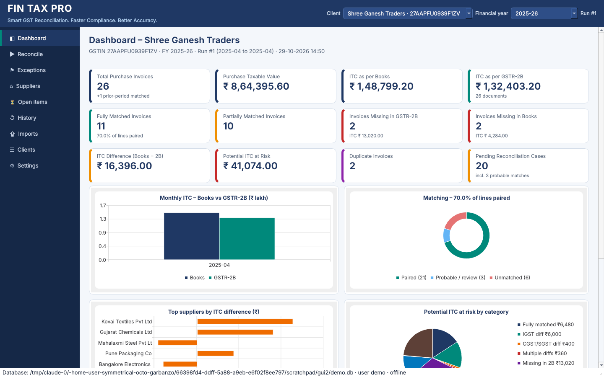

## What it does

* **Clients** – client master with GSTIN validation (check digit), several GSTINs per PAN,
  data and history fully separated per client.
* **Imports** – TallyPrime purchase register (title rows, ledger-wise tax columns such as
  "Input CGST 9%" summed automatically, Debit Note vouchers), custom registers (Excel/CSV),
  GSTR-2B portal Excel (B2B, B2BA, B2B-CDNR, B2B-CDNRA) and JSON, GSTR-2A JSON/Excel, ZIP.
  Layout and heading row are detected automatically; headings are mapped by synonyms
  ("Bill No", "Supplier Invoice No.", "Integrated Tax", "State/UT Tax" …). Unknown layouts
  ask for a mapping, which can be saved as a template.
* **Import preview** – valid documents, rejected rows with reasons and original values,
  duplicate rows, rows already imported, warnings. Nothing is silently dropped or changed.
  The same file cannot be imported twice; documents already in the database are skipped
  and logged.
* **Matching** – exact, invoice-number variations (`INV/001/26` = `INV-001-26`, `PP-7` =
  `PP-0007`), date differences within a configurable tolerance, per-component amount
  differences, credit/debit notes matched separately with correct signs, amendments,
  previous-period invoices, GSTIN mismatches and fuzzy suggestions with confidence and
  reasons (never auto-confirmed). Duplicates and ambiguous candidates go to review.
  Results are deterministic and every document appears exactly once.
* **17 reconciliation categories**, exception status/remarks/assignee/action date with a
  full audit trail, carried forward when a period is re-run.
* **Reports** – one Excel workbook with 17 sheets (executive summary with formula
  cross-checks, complete reconciliation, category sheets, supplier-wise and month-wise
  summaries with charts, GSTR-3B working, pending action register with status drop-down,
  source files and settings) plus a PDF summary.
* **Outward supplies** – sales register vs GSTR-1 with the same engine; GSTR-1 section
  totals and the sales register vs GSTR-3B Table 3.1 with classified findings (possible
  short payment, Rule 88C limit, segment differences).
* **Compliance** – month-by-month status of every client (red / amber / green) with
  issues and due dates; annual dashboard in Excel, client summary in PDF.
* **Letters and working papers** – supplier letters in Word, PDF and unsent e-mail drafts;
  period-wise working-paper ZIPs with manifest, SHA-256 check and reviewer sign-off.
* **Sync and web** – encrypted sync packages for a cloud folder, only with the client's
  recorded authorisation; read-only web view with login for Android phones.
* **Annual and calendar** – import the portal's Table 8A document details; see returns due
  and overdue across clients, with extensions recorded from CBIC notifications.
* **Safety** – local SQLite database (or PostgreSQL for a shared office server), exact decimal money, transactional imports and runs
  (cancel = nothing saved), backups before migrations, backup/restore commands, audit log.
  No GST portal credentials are needed. No data leaves the computer unless you export an
  encrypted sync package or start the web view yourself.

## Install

```bash
cd gst_recon
python -m venv .venv
# Windows: .venv\Scripts\activate      Linux/macOS: source .venv/bin/activate
pip install -r requirements.txt
pip install -e .            # provides the `fintax-gst` command
```

Python 3.12+ is required. To build a Windows `.exe` see [docs/BUILD_WINDOWS.md](docs/BUILD_WINDOWS.md).

## Try the demo (2 minutes)

```bash
fintax-gst demo --out demo_output
```

This creates a fresh database, generates the sample files, imports March and April books
and April GSTR-2B, reconciles April 2025 and writes the Excel and PDF reports into
`demo_output/reports/`. It then imports the April sales register and GSTR-1, reconciles
them, and writes the outward workbook, the compliance dashboard and PDF, the supplier
letters and a working-paper ZIP. The sample files and the expected category of every scenario are
in [sample_data/](sample_data/) ([EXPECTED_RESULTS.md](sample_data/EXPECTED_RESULTS.md)).

## Desktop application

```bash
python -m fintax_gst.ui            # or: fintax-gst-gui     (Windows: FinTaxPro.exe)
```

The header has selectors for the **client** and the **financial year**.
The navigation on the left opens these pages:

| Page | What you do there |
|---|---|
| **Dashboard** | 12 cards: invoices, taxable value, ITC (books and GSTR-2B), fully and partially matched, missing on each side, ITC difference, ITC at risk, duplicates, pending. 4 charts: monthly ITC, matching %, top supplier differences, ITC at risk by category. A financial-year overview by month. |
| **Reconcile** | The 10-step journey. Pick the client and the period (month, quarter, FY or custom range). Import the purchase register and GSTR-2B (plus earlier books or GSTR-2A, optional). Validate the imported files, set tolerances, start the reconciliation, review the summary, go to exceptions, export Excel and PDF. Long steps show a progress bar with **Cancel**; cancelling saves nothing. |
| **Exceptions** | Colour-coded category filters with counts, search, and a status filter. Books and GSTR-2B side by side with every difference and reason. Set status, assignee, action date and remarks. **Confirm match**, **Manual match** (Ctrl+click two lines), **Unmatch**, **Pending clarification**. Attach evidence. Line history. |
| **ITC review** | Flags for professional review with statutory references and guidance (17(5) indicators, 16(2)(aa), 16(4) time limit, RCM, ITC not available, IMS, credit notes). Confirm or dismiss each flag with a reason. ITC summary buckets. Claim register: claim eligible documents, reverse, reclaim – never twice. Rule configuration for all clients or one client. |
| **GSTR-3B & annual** | Import GSTR-3B (portal JSON or template, incl. Table 6.1 payments). GSTR-9 working (Tables 4–9) and GSTR-9C reconciliation with audited figures. Table 4 working: GSTR-2B auto vs books / claim register vs filed, with differences classified as statutory, timing or accounting. GSTR-9 Table 8 (8A–8D) with month-wise ITC and annual workbook export; import the portal's Table 8A document details and reconcile the year's books with them. |
| **IMS** | Import the IMS download and compare with books and GSTR-2B: rejected but booked, rejected but still in GSTR-2B (recompute), pending, accepted but not booked, value differences. Nothing is done on the portal. |
| **Sales & GSTR-1** | Import the sales register and GSTR-1, reconcile them, and see the GSTR-1 / sales register vs GSTR-3B Table 3.1 working with segments and classified differences. |
| **Compliance** | Every client's status for the financial year, month by month, with issues; export the dashboard (Excel) or a client compliance PDF. *Returns calendar* tab: returns due and overdue across clients (monthly / QRMP), and due-date extensions recorded from CBIC notifications. |
| **Letters & papers** | Supplier discrepancy letters (Word / PDF / e-mail draft) from the current run; prepare, verify and sign off audit working papers. |
| **Suppliers** | Supplier summary with all sort options and drill-down to invoices. Vendor follow-up register (contact, status, next follow-up date, remarks); due follow-ups are flagged. |
| **Open items** | Every document without a confirmed counterpart, across all periods, listed once. Double-click for its history across runs. |
| **History** | All runs with their summaries. Open a run, or re-run a period: review work and manual decisions carry forward. Lists the active manual decisions. |
| **Imports** | Imported files with SHA-256, counts and the full import log (including rejected rows). Import a file here, or remove an import no run has used. |
| **Clients** | Client master (GSTIN validated, PAN and state derived). |
| **Security** | Users and roles, change password, encrypted backup and restore, automatic backup and retention, audit log viewer and CSV export, permanent client deletion. |
| **Sync & web** | Record or revoke the client's sync authorisation, export or import encrypted sync packages, start or stop the web view, allow uploads from it. |
| **Settings** | Default tolerances, backup now, restore, data folder. |

On first start the app asks you to create the administrator. After that, every start
needs a login, and each role sees only the actions it may perform (see
[docs/SECURITY.md](docs/SECURITY.md)).

Every import opens a **preview** first, with tabs for documents, issues and the column
mapping. If headings aren't recognised, or you choose *Change column mapping…*, the
**mapping screen** opens. Drag file columns onto fields, or select a field and
double-click a column. You can save the mapping as a template.

Manual decisions are applied to the open run straight away and stored. Every later run
re-applies them (see [docs/RECONCILIATION_LOGIC.md](docs/RECONCILIATION_LOGIC.md) §8).

| Reconcile | Exceptions |
|---|---|
| 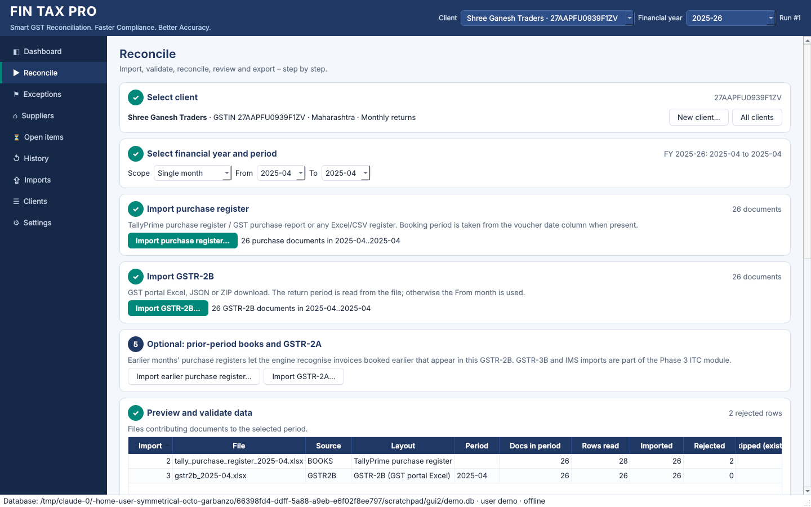 | 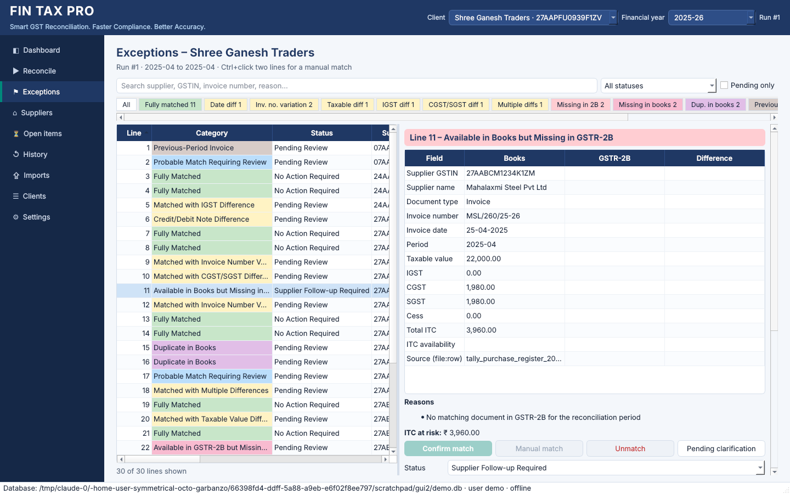 |
| **Suppliers** | **Import preview** |
| 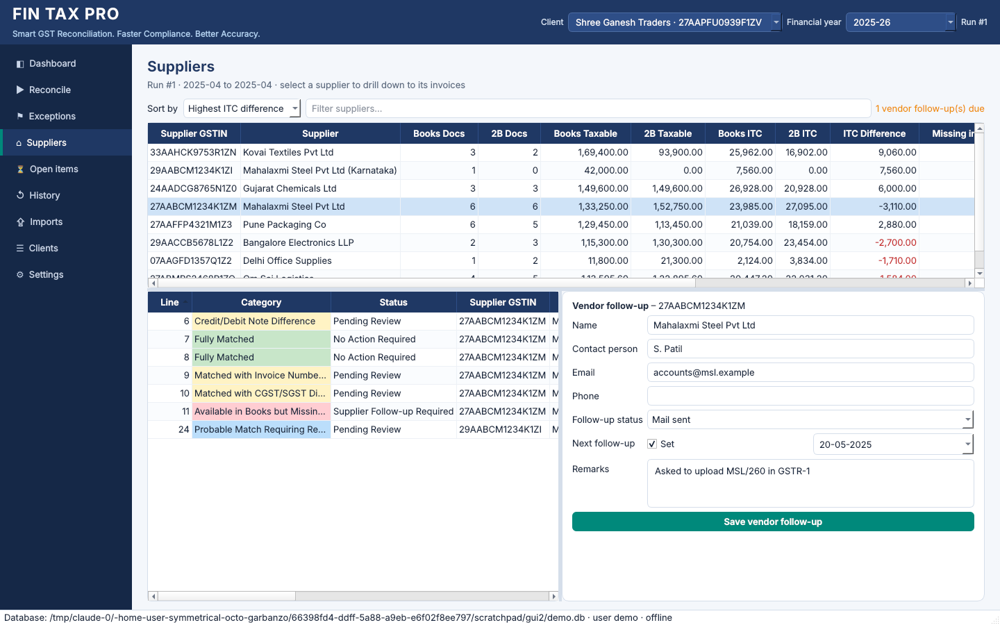 | 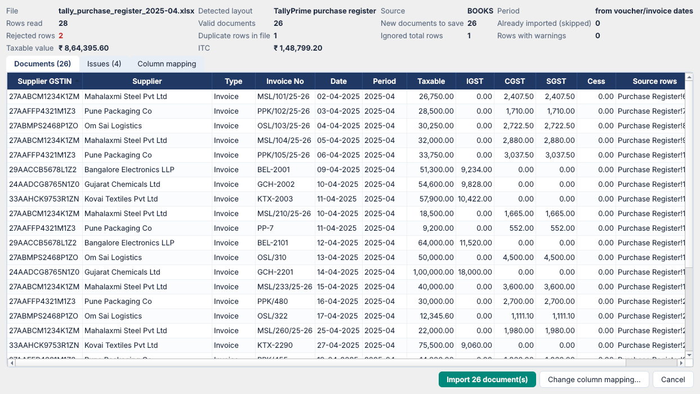 |
| **ITC review** | **GSTR-3B Table 4 working** |
| 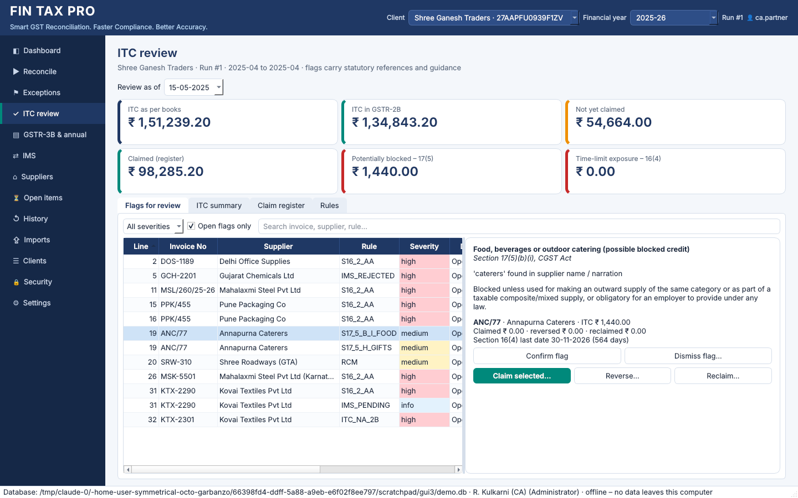 | 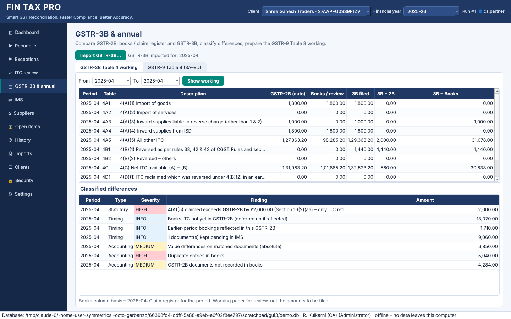 |
| **IMS review** | **Security** |
| 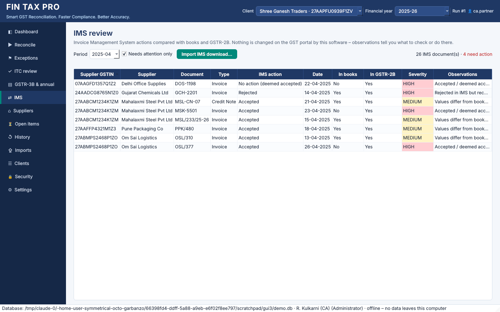 | 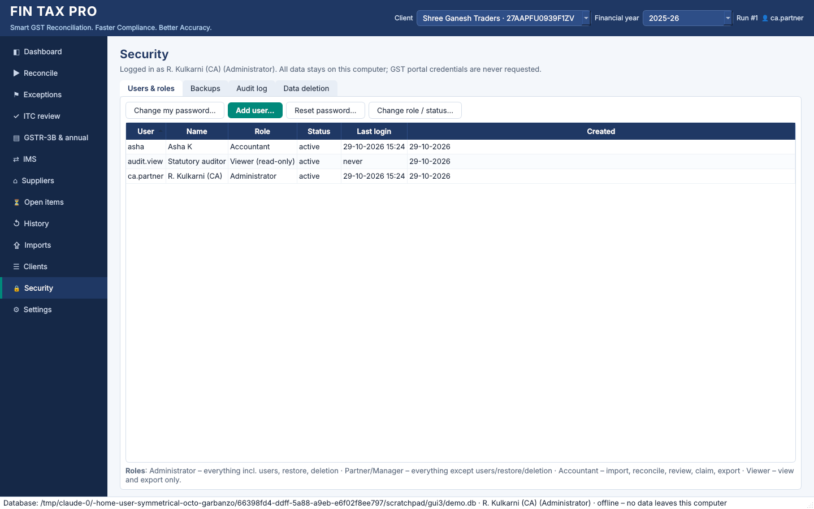 |
| **Sales & GSTR-1** | **Compliance dashboard** |
| 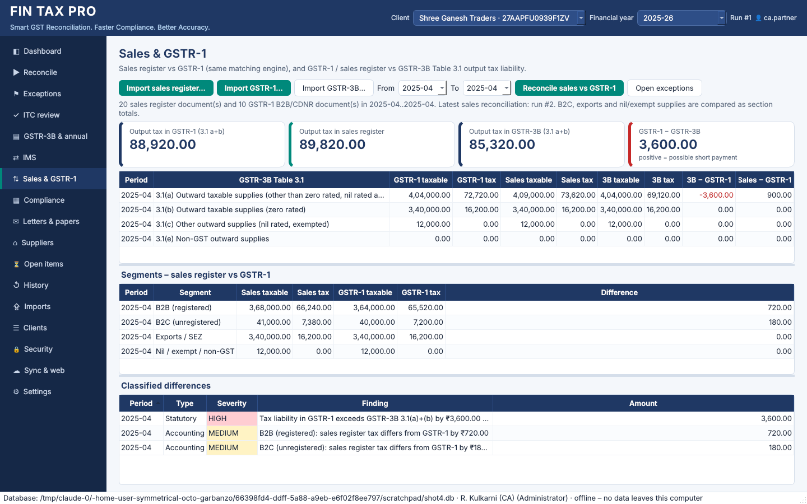 | 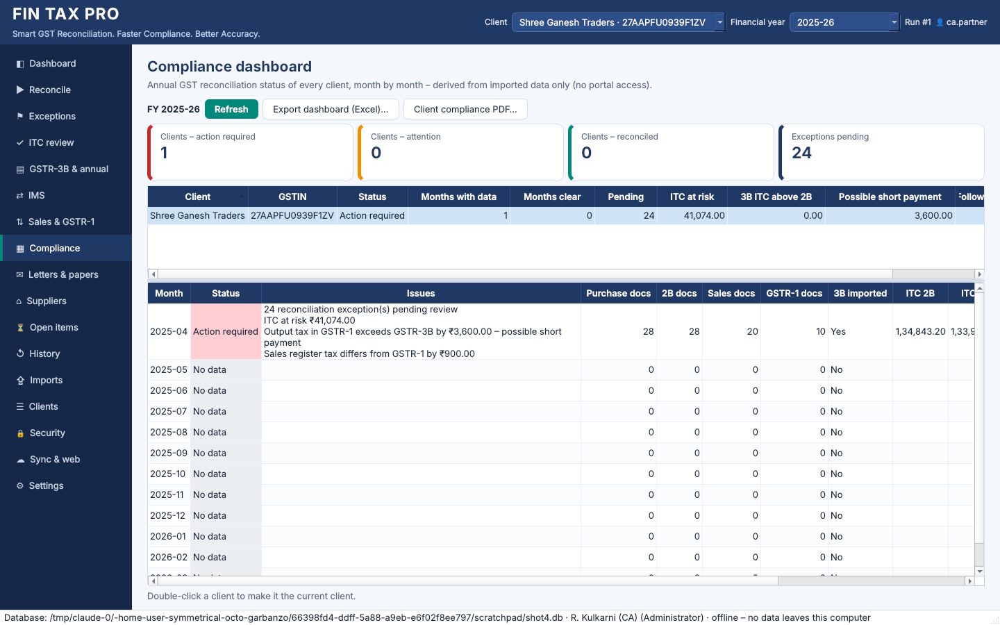 |
| **Letters & papers** | **Sync & web** |
| 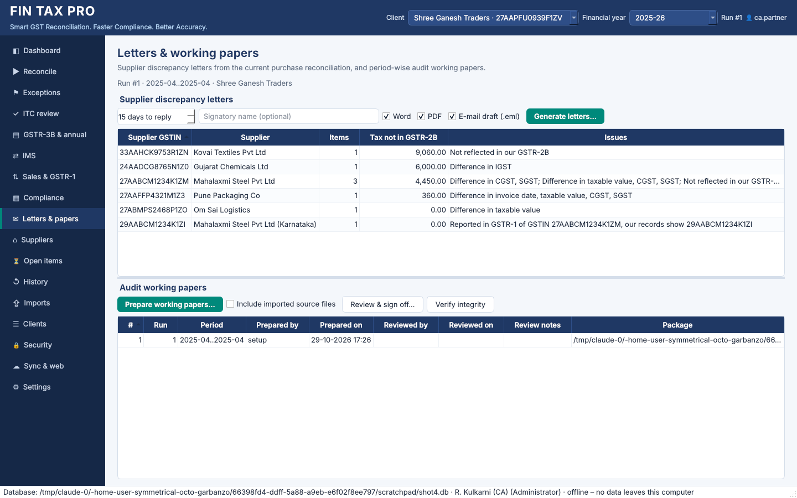 | 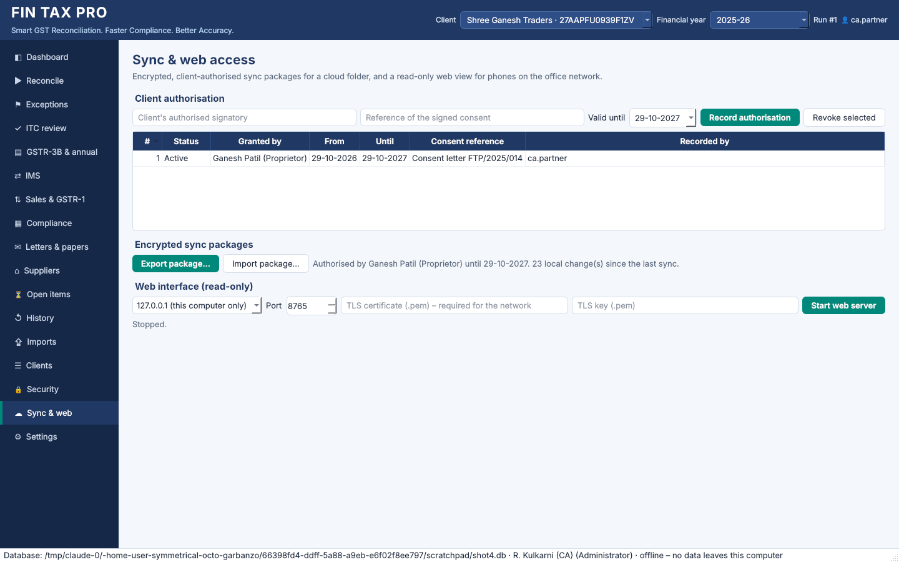 |
| **GSTR-9 Table 8 with portal 8A** | **Returns calendar** |
| 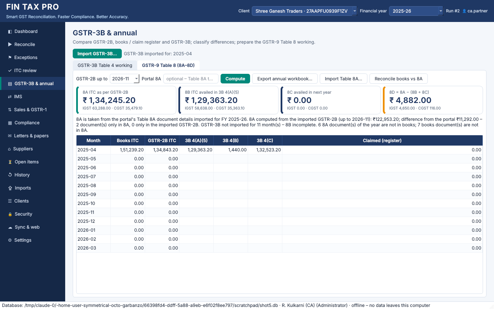 | 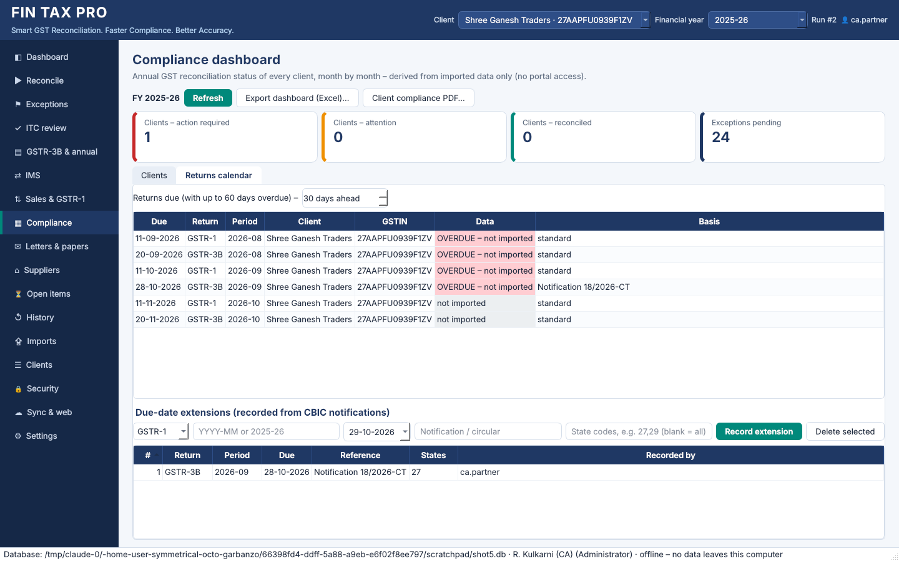 |
| **GSTR-9 Tables 4–7, 9** | **GSTR-9C** |
|  | 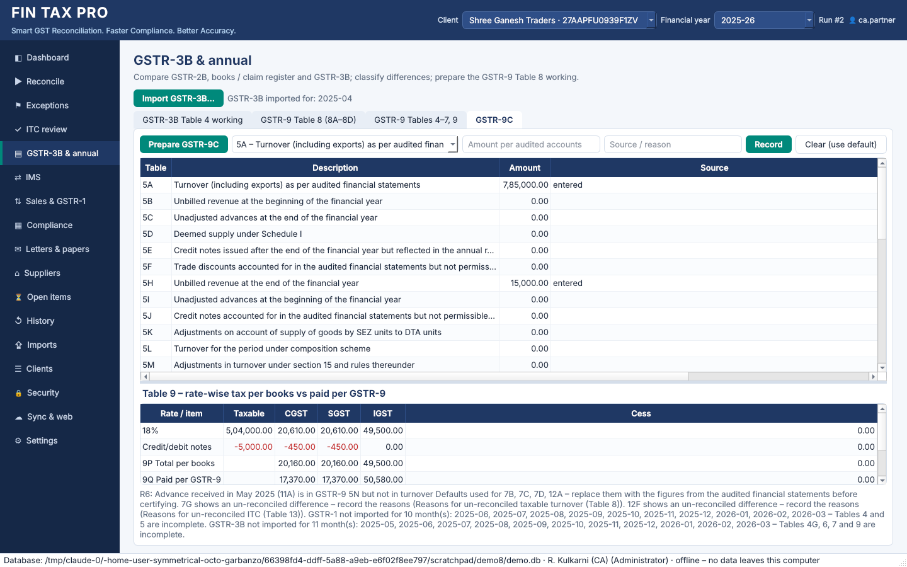 |

## Everyday workflow from the command line

```bash
# 1. Client (once)
fintax-gst client add --gstin 27AAPFU0939F1ZV --name "Shree Ganesh Traders" --fy 2025-26

# 2-3. Purchase register – preview first, then import
fintax-gst import --client 27AAPFU0939F1ZV --source books --file "Purchase Register Apr.xlsx" --preview
fintax-gst import --client 27AAPFU0939F1ZV --source books --file "Purchase Register Apr.xlsx"

# 4. GSTR-2B (period read from the file; give --period 2025-04 if it cannot be detected)
fintax-gst import --client 27AAPFU0939F1ZV --source gstr2b --file returns_R2B_042025.zip

# 5-8. Reconcile and export
fintax-gst reconcile --client 27AAPFU0939F1ZV --from 2025-04 --export reports/
#      quarter: --from 2025-04 --to 2025-06     full year: --fy 2025-26
#      options: --date-tolerance 3|7|15  --amount-tolerance 1.00  --no-fuzzy

# 9. Work the exceptions
fintax-gst show --run 1 --pending --reasons
fintax-gst update-line --run 1 --line 12 --status "Supplier Follow-up Required" \
    --remarks "Mailed on 20-May" --assign Asha --action-date 2025-05-20

# 10. Re-export after updates
fintax-gst export --run 1 --out reports/
```

Manual decisions, vendors, evidence and open items:

```bash
fintax-gst match confirm --run 1 --line 2 --remarks "Supplier confirmed typo"
fintax-gst match pair    --run 1 --line 11 --with 22 --remarks "Same purchase"
fintax-gst match unmatch --run 1 --line 27 --remarks "Different consignment"
fintax-gst match clarify --run 1 --line 10 --remarks "Asked client for invoice copy"
fintax-gst vendor --client 1 --gstin 27AABCM1234K1ZM --status "Mail sent" --next 2025-05-10
fintax-gst attach --run 1 --line 11 --file supplier_reply.pdf --description "Supplier reply"
fintax-gst open-items --client 1
```

ITC module, returns and security:

```bash
fintax-gst user add --username admin --role admin          # first user; afterwards add --login admin
fintax-gst --login admin import --client 1 --source ims --file ims_042025.json
fintax-gst --login admin gstr3b import --client 1 --file GSTR3B_042025.json
fintax-gst --login admin itc review --run 1                 # flags + ITC summary
fintax-gst --login admin itc decide --client 1 --invoice 42 --rule S17_5_B_I_FOOD \
    --decision dismissed --remarks "Raw material supplier"
fintax-gst --login admin itc claim --run 1 --period 2025-04 # eligible documents, never twice
fintax-gst --login admin itc reverse --client 1 --invoice 42 --period 2025-10 \
    --reason "Not paid within 180 days" --rule-ref RULE_37_180
fintax-gst --login admin itc table4 --client 1 --from 2025-04 --to 2025-06
fintax-gst --login admin itc rules --client 1 --add-gstin CLIENT_BLOCKED_GSTIN 27ABCDE1234F1Z5
fintax-gst --login admin ims --client 1 --period 2025-04
fintax-gst --login admin annual --client 1 --fy 2025-26 --out reports/
fintax-gst --login admin secure-backup --to D:/backup/fintax.ftpbk   # password: prompt or FINTAX_BACKUP_PASSWORD
fintax-gst --login admin audit-export --out audit.csv
fintax-gst --login admin purge-client --client 1 --confirm 27AAPFU0939F1ZV
```

Phase 4 – outward supplies, compliance, letters, working papers, sync and web:

```bash
fintax-gst --login admin import --client 1 --source sales --file tally_sales_register_2025-04.xlsx
fintax-gst --login admin import --client 1 --source gstr1 --file GSTR1_042025.json
fintax-gst --login admin reconcile --client 1 --from 2025-04 --compare gstr1 --export reports/
fintax-gst --login admin liability --client 1 --from 2025-04            # GSTR-1 vs sales vs 3B Table 3.1
fintax-gst --login admin compliance --fy 2025-26 --out reports/ --pdf    # all clients
fintax-gst --login admin letters --run 1 --out letters/ --signatory "R. Kulkarni"
fintax-gst --login admin papers prepare --run 1 --out working_papers/
fintax-gst --login partner papers review --id 1 --notes "Reviewed"       # a different user signs off
fintax-gst --login admin papers verify --id 1
fintax-gst --login admin sync authorise --client 1 --granted-by "Ganesh Patil (Proprietor)" \
    --valid-until 2026-03-31 --evidence "Consent letter 2025/014"
fintax-gst --login admin sync export --client 1 --folder "D:/OneDrive/FinTaxSync"   # FINTAX_SYNC_PASSWORD or prompt
fintax-gst --login admin sync import --file "D:/OneDrive/FinTaxSync/FTP_SYNC_....ftpsync"
fintax-gst --login admin serve --host 0.0.0.0 --certfile cert.pem --keyfile key.pem
```

Phase 5 – Table 8A, calendar, PostgreSQL, web uploads:

```bash
fintax-gst --login admin import --client 1 --source gstr8a --file GSTR9_8A_2025-26.json
fintax-gst --login admin annual --client 1 --fy 2025-26 --out reports/      # 8A from the portal file
fintax-gst --login admin reconcile --client 1 --fy 2025-26 --compare gstr8a  # books vs Table 8A
fintax-gst --login admin calendar                                            # due in 30 days + overdue
fintax-gst --login admin calendar extend --return GSTR-3B --period 2025-04 --due 2025-05-27 \
    --reference "Notification 9/2025-CT" --states 27
fintax-gst --login admin setting set web_uploads true
fintax-gst --login admin db-copy --to "postgresql+psycopg://fintax@dbserver/fintax"
fintax-gst --db "postgresql+psycopg://fintax@dbserver/fintax" --login admin runs --client 1
fintax-gst --login admin gstr9 --client 1 --fy 2025-26 --out reports/     # GSTR-9 Tables 4–9 + Table 8
fintax-gst --login admin gstr9c set --client 1 --fy 2025-26 --item 5A --amount 785000 --note "AFS note 21"
fintax-gst --login admin gstr9c --client 1 --fy 2025-26                  # GSTR-9C Tables 5, 7, 9, 12
```

Other commands: `client list [--pan]`, `imports --client X [--remove ID]`, `runs --client X`,
`backup [--to file]`, `restore file`, `sample-data --out dir`. Use `--db path` to work with
a specific database file.

### When headings are not recognised

The import stops and lists the columns it found. Create a mapping file:

```json
{"fields": {"supplier_gstin": ["Party GSTIN"], "invoice_no": ["Bill Ref"],
            "invoice_date": ["Bill Dt"], "taxable_value": ["Basic"],
            "igst": ["IGST"], "cgst": ["CGST"], "sgst": ["SGST"]}}
```

and import with `--mapping mapping.json --save-template "Client X register"`; next time use
`--template "Client X register"`. Several columns may be listed for one amount field; they
are added together.

## Tests and benchmark

```bash
python -m pytest              # 199 tests: engine, importers, ITC, outward, compliance, letters, working papers,
                              # sync, web, Table 8A, calendar, GSTR-9/9C, security, reports, CLI, desktop UI
FINTAX_TEST_DB_URL=postgresql+psycopg://user@localhost/fintax_test python -m pytest   # same suite on PostgreSQL
python scripts/benchmark.py 10000 50000
```

Measured on the 4-core Linux build container used for development (synthetic data:
80 % exact, plus format variations, date/amount differences, missing, duplicates, typos):

| Invoices per side | Import (both files) | Reconcile + save | Excel (17 sheets) + PDF | Total |
|---:|---:|---:|---:|---:|
| 10,000 | 2.8 s | 2.0 s | 14.2 s | 19.0 s |
| 50,000 | 15.7 s | 13.1 s | 80.1 s | 108.9 s |

These Phase 1 measurements cover the engine and the reports.

Desktop app, measured on the same machine:

| Lines in the run | Start | Switch page | Save a review | Search filter |
|---:|---:|---:|---:|---:|
| 10,000 | 1.4 s | ≤ 0.8 s | 0.1 s | 0.1 s |
| 50,000 | 7.0 s | ≤ 2.7 s (first visit) | 0.2 s | 0.4 s |

Timings on an office PC will differ. Run the script on the target machine.

## Documentation

* [docs/ARCHITECTURE.md](docs/ARCHITECTURE.md) – layers, file structure, database
* [docs/RECONCILIATION_LOGIC.md](docs/RECONCILIATION_LOGIC.md) – exactly how matching works
* [docs/ITC_MODULE.md](docs/ITC_MODULE.md) – ITC rules, 16(4), claims, Table 4, GSTR-9 Table 8, IMS
* [docs/PHASE7.md](docs/PHASE7.md) – advances, Table 6.1 payments, GSTR-9C
* [docs/PHASE6.md](docs/PHASE6.md) – GSTR-9 working, web column mapping, Windows CI build
* [docs/PHASE5.md](docs/PHASE5.md) – Table 8A, returns calendar, PostgreSQL, web uploads, signing
* [docs/PHASE4.md](docs/PHASE4.md) – sales vs GSTR-1, GSTR-3B liability, compliance, letters, working papers, sync, web
* [docs/SECURITY.md](docs/SECURITY.md) – login, roles, encryption, backups, deletion, sync and web
* [docs/BUILD_WINDOWS.md](docs/BUILD_WINDOWS.md) – Windows executables (desktop and CLI)
* [docs/ROADMAP.md](docs/ROADMAP.md) – phases and what comes next

## Professional note

Categories and "ITC at risk" are indicators for professional review. Appearance in
GSTR-2B does not by itself establish ITC eligibility, and the software does not issue
legal conclusions or perform any action on the GST portal.
