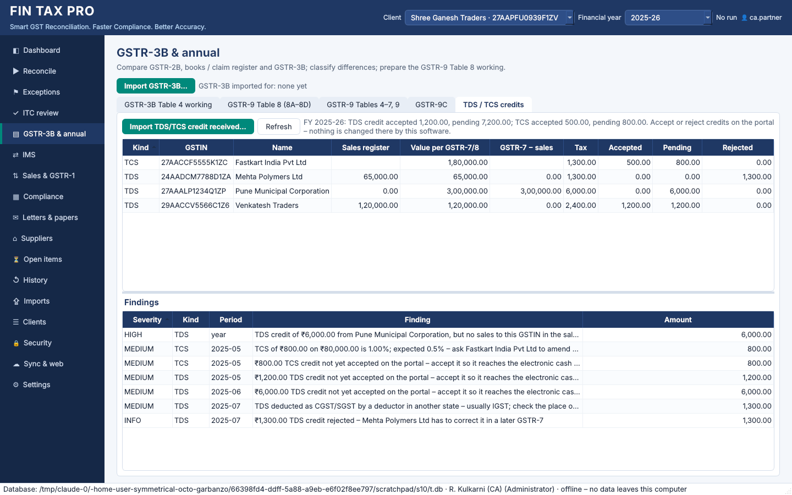

# Phase 10 – e-invoice and e-way bill reconciliation, TDS/TCS credits, GSTR-9 draft JSON

## 1. Sales register vs e-invoices (IRP) and e-way bills

Two more comparisons for the sales register, next to GSTR-1. They use the same matching
engine, review screens, reports and audit trail.

| Comparison | Right-hand side | Documents compared |
|---|---|---|
| `SALES_VS_EINV` | e-invoice report from the e-invoice portal (one row per IRN) | B2B, SEZ and export documents; B2C, nil/exempt and non-GST supplies are not e-invoiced and are left out |
| `SALES_VS_EWB` | report of e-way bills generated, from the e-way bill portal | every sales document |

### Importing the reports

Download the reports as Excel or CSV from the portals and import them as **e-Invoice
report** or **e-Way bill report**. The usual headings are recognised automatically, and
anything else can be mapped on the mapping screen:

* *Ack No*, *IRN*, *Doc No / Date / Type*, *Buyer GSTIN* and *Status* on the e-invoice
  report;
* *EWB No*, *Supply Type*, *Doc No / Date / Type*, *Other Party* / *To GSTIN*, *Assessable
  Value* and *Status* on the e-way bill report.

How rows are read:

* **Month.** Each document belongs to the month of its document date. No return period is
  asked for.
* **Recipient GSTIN.** *URP* (unregistered, exports) is read as a blank GSTIN, as in the
  sales register.
* **Cancelled IRN / e-way bill** (*CNL*, *Cancelled*). The row is imported with its status
  and a warning. It is not counted as reporting the document.
* **Rows that are not compared**, listed as *ignored* in the import log with the reason:
  * inward e-way bills (goods received);
  * e-way bills for delivery challans, bills of entry and *others*.
* **One row per IRN / e-way bill.** Rows are never merged. When the same invoice has a
  cancelled and a regenerated e-way bill, both are kept and are not reported as
  duplicates.
* **Latest import wins.** When the same IRN or e-way bill number is imported again, for
  example from a later report that shows it cancelled, the latest import is used.

### What the run explains

Lines keep their category. Explanations are added to the line's *reasons*; your remarks
stay yours.

| Situation | Explanation | Status |
|---|---|---|
| Sale in the register, its IRN / e-way bill cancelled | the IRN / e-way bill number was cancelled, the sale is still in the register: confirm whether it was made | Client clarification |
| B2B / export sale without an IRN | not a valid tax invoice for a taxpayer required to e-invoice | Pending review |
| Sale without an e-way bill, value ≥ threshold | needed if goods worth more than the threshold moved | Pending review |
| Sale without an e-way bill, value below the threshold | below the e-way bill threshold | No action (automatic) |
| Credit / debit note, or SAC 99 services only, without an e-way bill | no e-way bill needed | No action (automatic) |
| IRN / e-way bill without a sale in the register | record the sale, or confirm that it was cancelled | Pending review |

**Threshold.** The threshold is the setting `ewb_threshold`, ₹50,000 by default. Some
states use a different limit for movement within the state; set it per firm:

```bash
fintax-gst setting set ewb_threshold 100000
```

**Re-runs.** A status set automatically is re-applied on a re-run, so a changed threshold
takes effect. A status you set yourself is kept.

```bash
fintax-gst import --client 1 --source einv --file einvoice_report_2025-04.csv
fintax-gst import --client 1 --source ewb --file ewaybill_report_2025-04.csv
fintax-gst reconcile --client 1 --from 2025-04 --compare einv
fintax-gst reconcile --client 1 --from 2025-04 --compare ewb
```

On the desktop, use *Sales & GSTR-1*: *Import e-invoice report…*, *Import e-way bill
report…*, then *Sales register vs* (GSTR-1 / e-Invoice (IRP) / e-Way bill) and
*Reconcile*. The web view accepts both reports as uploads.

Sample files: `sample_data/einvoice_report_2025-04.csv` and
`sample_data/ewaybill_report_2025-04.csv`. The expected results are in
`EXPECTED_RESULTS.md`.

### A correction: review work stays with its comparison

A re-run carries the earlier status, remarks and assignee forward. Before, it took them
from the latest run of the period, whatever that run compared. A books vs GSTR-2A run
could therefore inherit statuses from a books vs GSTR-2B run. Now only runs of the same
comparison are used.

The GSTR-1 liability sheets are added only to sales vs GSTR-1 reports.

## 2. TDS and TCS credits received (GSTR-7 / GSTR-8)

When a customer deducts TDS, or an e-commerce operator collects TCS, the credit appears
on the portal under *TDS and TCS credit received*:

| | Who | Rate | On |
|---|---|---|---|
| TDS (section 51) | government departments and other notified deductors | 2% (1% CGST + 1% SGST, or 2% IGST) | taxable value paid under a contract above ₹2.5 lakh |
| TCS (section 52) | e-commerce operators | 1% until 9 July 2024, **0.5% from 10 July 2024** | net value of supplies made through the operator |

The client accepts or rejects each credit on the portal. An accepted credit goes to the
electronic cash ledger.

**Import.** Download the page as Excel or CSV; the TDS and TCS sheets are both read. Then
use *GSTR-3B & annual → TDS / TCS credits → Import…*, or:

```bash
fintax-gst tds-tcs import --client 1 --fy 2025-26 --file tds_tcs_credit_2025-26.xlsx --preview
fintax-gst tds-tcs import --client 1 --fy 2025-26 --file tds_tcs_credit_2025-26.xlsx
fintax-gst tds-tcs --client 1 --fy 2025-26
```

* Each sheet is identified by its headings: *deductor* / *GSTR-7* for TDS; *e-commerce
  operator* / *GSTR-8* for TCS.
* For TCS, a missing net value is computed as gross value less supplies returned.
* **Rows that are not imported** are listed with the reason: an invalid GSTIN, an
  unreadable tax period, or a row that cannot be identified as TDS or TCS.
* **Re-importing a later download** adds only new credits. A credit already imported
  (same kind, period, party and amounts) only takes the newer action, for example
  *pending → accepted*. The change is audited.
* Removing the import removes its credits. Credits travel in sync packages and are
  removed by a client purge.

**Statement.** The statement covers the financial year and shows:

* **by deductor / operator:** the value per GSTR-7/8, the tax, and how much is accepted,
  pending and rejected. For TDS it also shows the sales register's taxable value to that
  GSTIN in the year and the difference;
* **by month:** the credit to the cash ledger;
* **findings:**

| Finding | Severity |
|---|---|
| TDS from a GSTIN with no sales in the sales register | high |
| GSTR-7 value above the sales to the deductor (an earlier year's invoices, or a deductor error) | medium |
| Tax not 2% (TDS) or not the TCS rate of the period (both rates accepted for July 2024) | medium |
| TDS charged as IGST by a deductor in the same state, or as CGST/SGST by one in another state | medium |
| Credit not yet accepted on the portal | medium |
| Credit rejected – the deductor / operator corrects it in a later return | info |
| Sales to the deductor not yet covered by GSTR-7 (payment due, contract up to ₹2.5 lakh, or not filed) | info |

Nothing is changed on the portal by this software. Accepting or rejecting a credit is
done there.

When credits are imported for the year, the annual workbook (`gstr9 --out`) gets a
*TDS-TCS Credits* sheet.

**Limitations.**

* TCS is not compared with the sales register, because the register does not show
  which sales went through the operator. Compare it with the operator's settlement
  statements.
* The portal JSON layout of this page is not read; use the Excel or CSV download.

Sample: `sample_data/tds_tcs_credit_2025-26.xlsx`.



## 3. Draft GSTR-9 JSON for the offline tool

The GSTR-9 working and the Table 8 working can be exported as a **draft** JSON in the
offline tool's layout, together with a mapping of every figure:

```bash
fintax-gst gstr9 json --client 1 --fy 2025-26 --out reports/
```

On the desktop: *GSTR-3B & annual → GSTR-9 Tables 4–7, 9 → Draft JSON for offline tool…*.

Two files are written:

| File | Content |
|---|---|
| `FINTAXPRO_GSTR9_DRAFT_<GSTIN>_FY<year>.json` | the draft |
| `…_mapping.csv` | for each table: description, JSON path, value, status and note |

Each figure in the mapping has one of three statuses:

* **included** – the figure is in the JSON and comes from the working (Tables 4 and 5,
  6A, 6F–6H, 7H, 8A–8C, Table 9 payable and paid in cash, interest and late fee paid,
  Tables 10–13, the entered Tables 15–16, and the HSN summaries of Tables 17 and 18);
* **computed by the offline tool** – sub-totals and differences (4H, 4M, 4N, 5G, 5L–5N,
  6I, 6J, 7I, 7J, 8D);
* **enter in the offline tool** – figures the imported data cannot split the way the
  return asks. **They are left out rather than guessed:**
  * 6B, 6C/6D and 6E, by inputs / capital goods / input services and by registered /
    unregistered supplier;
  * 7A–7G, by rule;
  * 6K–6M, transition credit and other ITC;
  * 8E–8K;
  * Table 9 tax paid through ITC, by the credit used;
  * Table 14.

The working's notes, such as months without GSTR-1 or GSTR-3B, are repeated at the end
of the mapping with the status *check*.

**This is a draft for review.**

* The key names follow GSTN's published GSTR-9 JSON as understood when this was written,
  and the portal format can change.
* Import the file into the GST offline tool, which validates it. Enter the items marked
  *enter in the offline tool* there, and check every table against the working before
  generating the file to upload.
* If the tool rejects a section, enter that section by hand.
* Nothing is filed or uploaded by this software. Each export is audited.

### Schema v9

| Change | Purpose |
|---|---|
| `invoices.irn` | e-invoice IRN |
| `invoices.ref_no` | e-invoice acknowledgement number / e-way bill number |
| `invoices.ref_status` | ACTIVE or CANCELLED |

### Schema v10

| Change | Purpose |
|---|---|
| `tds_tcs_credits` | TDS / TCS credits received: kind, period, deductor / operator, value, tax, action |
