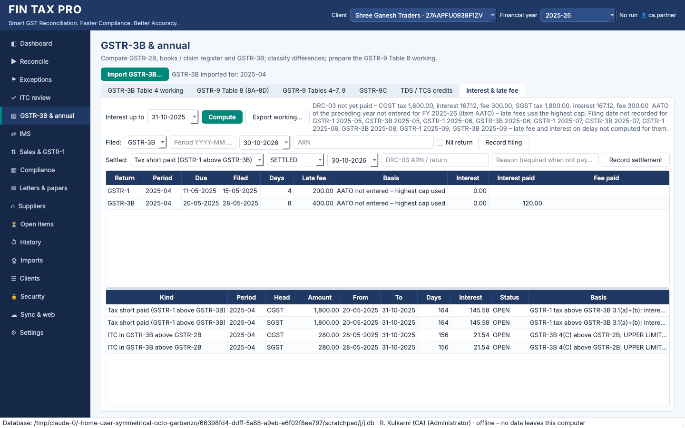

# Phase 11 – interest and late fees

## 1. Interest (section 50) and late fees (section 47)

*GSTR-3B & annual → Interest & late fee*, or `fintax-gst interest`, works out for a
financial year, up to an *as of* date:

| What | Basis | From → to |
|---|---|---|
| Late fee on GSTR-1 / GSTR-3B | ₹25 + ₹25 per day (nil: ₹10 + ₹10), capped by the AATO slab (Notifications 19/2021 and 20/2021-CT): ₹250 / ₹1,000 / ₹2,500 / ₹5,000 per head | due date → date of filing |
| Interest on a late GSTR-3B | 18% p.a. on the tax paid **in cash** (GSTR-3B Table 6.1) – section 50(1) proviso, rule 88B(1) | due date → date of filing |
| Interest on tax short paid | 18% p.a. on GSTR-1 tax above GSTR-3B 3.1(a)+(b), per head | GSTR-3B due date → date paid (DRC-03), or the *as of* date |
| Interest on ITC above GSTR-2B | 18% p.a. on GSTR-3B 4(C) above the GSTR-2B figure, per head – section 50(3) | date the GSTR-3B was filed → date reversed / paid, or the *as of* date |
| Late fee on GSTR-9 | ₹25 / ₹50 / ₹100 per head per day by AATO, capped at 0.02% / 0.02% / 0.25% of the turnover (Notification 07/2023-CT), from FY 2022-23; nothing when GSTR-9 is optional (AATO up to ₹2 crore) | 31 December → date of filing |

How each amount is computed:

* **Interest** = amount × 18% × days / 365. The days run from the day after the due date.
* **Late fees.** Periods before June 2021 had amnesties and waivers that vary by period,
  so their late fees are not computed and the working says so.
* **ITC above GSTR-2B is an upper limit.** Under rule 88B(3), wrongly availed ITC counts
  as utilised only when the credit ledger falls below it. Ledger balances are not
  imported, so the working assumes it was used when the return was filed, and labels the
  figure *UPPER LIMIT*.
* **Data must be present.** A month is checked only when the data is there:
  * short payment: GSTR-1 and GSTR-3B of that month;
  * excess ITC: GSTR-2B and GSTR-3B.
  
  A month without GSTR-2B is noted, never reported as all-excess.

### What you record

**Filing dates.** Record them one by one, or import a CSV with *Return Type, Tax Period,
Date of Filing* and optionally *ARN* and *Nil Return*. Every change is audited.

```bash
fintax-gst interest filed --client 1 --return GSTR-3B --period 2025-04 --date 2025-05-28 --arn AA270425000202L
fintax-gst interest import-filings --client 1 --file returns_filed_2025-26.csv
```

**Settlements.** For each month, record how a short payment or excess ITC was dealt
with: *SETTLED* with the date of payment or reversal (DRC-03, a later GSTR-3B), or
*NOT_PAYABLE* with the reason (for example ITC on a bill of entry, which is not in
GSTR-2B). A settled amount stops accruing interest on that date.

```bash
fintax-gst interest settle --client 1 --kind SHORT_PAYMENT --period 2025-04 --status SETTLED --date 2025-06-19 --reference "DRC-03 AD2706250001"
fintax-gst interest settle --client 1 --kind EXCESS_ITC --period 2025-04 --status NOT_PAYABLE --note "ITC on bill of entry"
```

**AATO.** Enter the preceding year's aggregate turnover once a year as item `AATO`
(`fintax-gst gstr9c set --item AATO --amount …`, or the GSTR-9C tab). It selects the
late-fee slab. Without it, the highest cap is used and the working says so.

### Output

```bash
fintax-gst interest --client 1 --fy 2025-26 --as-of 2025-10-31 --out reports/
```

The workbook (*Interest & Late Fee*) lists:

* the returns filed late, with the late fee, the interest, and the interest and late fee
  already paid per GSTR-3B Table 6.1;
* the short payments and excess ITC, with their periods, days, interest and status;
* a **DRC-03 summary** of what is not yet paid, by head (tax, interest, late fee).

Interest up to a settlement date stays in that summary until you confirm it was paid with
the tax.



The working is for the professional. The amounts the portal levies are the ones to pay,
and nothing is paid or filed by this software.

Sample: `sample_data/returns_filed_2025-26.csv`. On the demo data:

* the April GSTR-1 is 4 days late and GSTR-3B 8 days late: late fees of ₹200 and ₹400;
* the ₹3,600 short payment carries ₹145.58 of interest per head up to 31-10-2025.

### Schema v12

| Change | Purpose |
|---|---|
| `return_filings` | date of filing, ARN and nil flag per return and period |
| `interest_settlements` | how a period's short payment / excess ITC was settled, or why nothing is payable |
