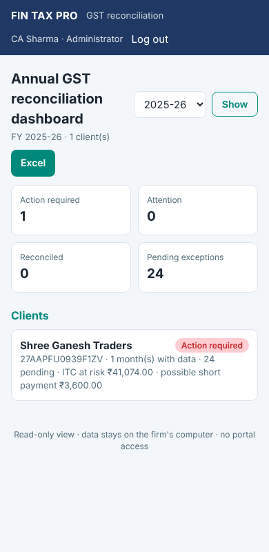
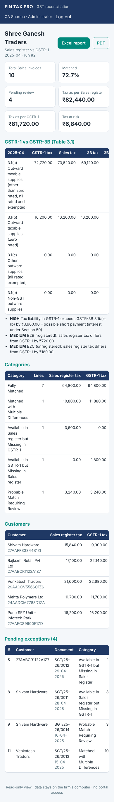

# Phase 4 – outward supplies, compliance, letters, working papers, sync and web

Every Phase 4 feature uses the same database, services and matching engine as the rest of
the application. Nothing here needs GST portal credentials. Nothing is sent anywhere
unless the user starts it (a sync package written to a folder, or the web view started
on the office network).

## 1. Sales register vs GSTR-1

**Imports**

* *Sales register*: the TallyPrime sales register, or any Excel/CSV register (source
  `sales`). Columns such as "Sales @18%" and "Output CGST 9%" are added up the same way
  as purchase ledgers. Sales and credit-note vouchers keep the supplier's sign.
  "Type of Supply" (Regular, SEZ, Export (LUT), Exempt …) is stored with each document.
* Customers without a GSTIN (cash sales, URP, B2C) are accepted with a blank GSTIN. They
  are never rejected.
* *GSTR-1*: the portal JSON (source `gstr1`). B2B, B2BA, CDNR and CDNRA become documents.
  Section totals are kept for every section (B2B, B2CL, B2CS, CDNR, CDNUR, EXP, NIL and
  the amendment sections) with place of supply, rate and supply type.

**Matching.** `fintax-gst reconcile --compare gstr1` (or the *Sales & GSTR-1* page) runs
the same engine, with the sales register on the left and GSTR-1 on the right. Every
category, manual decision, status and report works as it does for purchases, and the
labels change to sales wording ("Missing in GSTR-1", "Customer"). Some supplies have no
document-level GSTR-1 record: B2C (blank GSTIN), nil-rated, exempt and non-GST supplies.
These are compared as section totals, so they never show up as "missing".

**GSTR-1 vs GSTR-3B Table 3.1** (`fintax-gst liability`, the *Sales & GSTR-1* page, and
the outward workbook):

| 3.1 row | GSTR-1 sections |
|---|---|
| (a) outward taxable | B2B / CDNR regular, B2CL, B2CS, CDNUR (B2CL) |
| (b) zero rated | EXP, SEZ with/without payment, CDNUR (exports) |
| (c) nil / exempt | NIL, EXEMPT |
| (e) non-GST | NONGST |

* Supplies under reverse charge (the recipient pays the tax) are shown separately.
* Amendment sections hold the *revised* values of earlier periods. The amount of the
  change can't be worked out from one return, so they are listed for manual adjustment
  and never added to the totals.

The working classifies its findings:

* **Statutory, high**: GSTR-1 tax above GSTR-3B 3.1(a)+(b), a possible short payment
  with interest under Section 50. A further finding is added when the gap is above the
  Rule 88C limit (₹25 lakh or 20 %, effective 26-12-2022), where a DRC-01B intimation is
  expected.
* **Statutory, medium**: GSTR-3B above GSTR-1.
* Taxable-value differences in 3.1(b), (c) and (e).
* **Accounting**: segment differences between the sales register and GSTR-1 (B2B, B2C,
  exports/SEZ, nil/exempt).

The Rule 88D check (ITC in GSTR-3B above GSTR-2B by more than the same limits, effective
04-08-2023) has been added to the GSTR-3B Table 4 working.

The outward workbook has the same sheets as the purchase workbook, relabelled. Two sheets
change: *GSTR-1 vs GSTR-3B* replaces the Table 4 sheet, and *GSTR-1 Section Totals*
replaces IMS. There is no ITC review sheet.


## 2. Compliance summary and annual dashboard

`ComplianceService.client_summary(client, fy)` checks every month of the year. It uses
only what has been imported and reconciled:

* the documents imported from each source;
* whether the GSTR-3B was imported;
* the latest inward and outward runs;
* ITC as per GSTR-2B and as claimed in 3B Table 4(A);
* output tax per GSTR-1, the sales register and 3B Table 3.1.

| Status | When |
|---|---|
| **Action required** (red) | possible short payment; ITC claimed in 3B above GSTR-2B (16(2)(aa)); data imported but not reconciled |
| **Attention** (amber) | exceptions pending; ITC at risk; GSTR-3B not imported (with its due date); one side of a pair not imported; sales register vs GSTR-1 differences |
| **Reconciled** (green) | data present, nothing above |
| **No data** (grey) | nothing imported for the month |

The software can't see the portal, so "GSTR-3B imported" is not proof that the return
was filed. Due dates are the standard monthly ones: GSTR-1 on the 11th and GSTR-3B on the
20th. CBIC extensions and QRMP dates are not modelled.

* **Annual dashboard**: every active client with its overall status and year totals. It
  is available on the *Compliance* page, through `fintax-gst compliance --fy 2025-26 --out
  dir`, and on the web home page. The Excel version has three sheets: Annual Dashboard,
  Month Status and Issues.
* **Client compliance PDF**: a landscape summary for the client file or the client
  meeting, with the month table, due dates and issues.


## 3. Supplier discrepancy letters

A letter only lists open lines that need action from the supplier:

* invoices in the books but not in GSTR-2B;
* matched documents with an amount difference (taxable value, IGST, CGST, SGST, cess,
  tax head);
* documents reported under another GSTIN;
* any line whose status is *Supplier follow-up / correction required*.

Two kinds of line are left out:

* lines marked for correction in the books, client clarification or timing differences;
* differences only in the invoice number or date.

Each letter has the client's letterhead details, a reference (`GST/<period>/<run>/<n>`),
the Section 16(2)(aa) explanation, a table of documents, the action requested for each
(report in GSTR-1/IFF, amend through B2BA/CDNRA, confirm the GSTIN), the tax not
reflected and a reply-by date.

* Formats: **Word** (.docx), **PDF**, and an **e-mail draft** (.eml, `X-Unsent: 1`) with
  the PDF attached. The draft opens in Outlook or Thunderbird for review. **Nothing is
  sent by the software.**
* Every letter is recorded in the letter register (`letters` table and audit log). The
  vendor follow-up register is set to *Letter issued*, with the next follow-up on the
  reply-by date (switch this off with `--no-register`).

```bash
fintax-gst letters --run 1                         # preview
fintax-gst letters --run 1 --out letters/ --signatory "R. Kulkarni" --reply-days 15
```

## 4. Audit working papers

`fintax-gst papers prepare --run 1 --out wp/` (or *Letters & papers*) writes one ZIP per
run. The ZIP is never changed afterwards.

```
00_Index.pdf                 run details, key figures, contents with SHA-256, sign-off block
01_Reconciliation/           the Excel workbook and PDF summary of the run
02_Compliance/               client compliance summary for the financial year
03_Supplier_letters/         letters issued from this run
04_Evidence/                 attachments on documents of the run (SHA-256 re-checked; altered files left out and noted)
05_Source_files/register.csv imported files with SHA-256 (the files themselves with --include-sources)
06_Audit_trail.csv           the client's audit log
manifest.json                every file with SHA-256 and size, run fingerprint, notes
```

* **Review sign-off**: `papers review --id N --notes "..."`. It needs the partner/manager
  or admin role, and the reviewer must be someone other than the preparer. The package
  is verified first. The sign-off is stored against the package's SHA-256 and in the
  audit log.
* **Verify**: `papers verify --id N` re-computes the ZIP's SHA-256 and every file's
  SHA-256 against the manifest.


## 5. Client-authorised synchronisation

The design aim is that the firm's own computers can share a client's data through a
cloud drive the firm already uses, while the cloud only ever holds ciphertext, and only
with the client's documented consent.

1. **Record the client's authorisation**: the signatory, a reference to the signed
   consent, the scope and a validity date (`sync authorise`). It can be revoked at any
   time. Exports are refused unless an authorisation is active.
2. **Export**: `sync export --client X --folder "D:/OneDrive/FinTaxSync"`. This writes
   `FTP_SYNC_<GSTIN>_<origin>_<seq>.ftpsync`, which is `FTPSY1` + a salt + a Fernet token
   (the key comes from scrypt of the password). The token holds a compressed snapshot of
   the client's data:
   * imports, documents, GSTR-1/3B, runs and lines;
   * manual decisions, ITC reviews, claims and rules;
   * vendors;
   * evidence files.
   The authorisation travels with the package.
3. **Import** on the other computer: `sync inspect` shows the client, origin, sequence,
   authorisation and row counts. `sync import` then replaces that client's snapshot with
   the package, and all database ids are remapped. The import is refused when:
   * the package is older than, or the same as, the last one imported from that computer;
   * it was created on this computer;
   * the authorisation in it has expired;
   * the client was changed locally since the last sync. This is a **conflict**: export
     the local work first, or pass `--replace-local`, which backs up the database first.
4. Letters, working-paper packages and the audit log stay on each computer. The import
   is itself audited.

The password never leaves the user, and the software opens no network connection.
Copying files to the cloud is left to the user's existing drive client.

## 6. Web interface for phones (read-only)

```bash
fintax-gst serve                                   # http://127.0.0.1:8765 on this computer
fintax-gst --login admin serve --host 0.0.0.0 --certfile cert.pem --keyfile key.pem
```

The desktop app can also start it from *Sync & web*.

* **Pages**
  * the annual dashboard (all clients, status pills);
  * a client's month status with issues and runs;
  * a run's figures, categories, top suppliers or customers, and pending exceptions;
  * for outward runs, the GSTR-1 vs GSTR-3B working.
* **Downloads**: the run workbook and PDF, the client compliance PDF and the dashboard
  Excel (needs the *export* permission; audited).
* **Phones**: responsive layout from 360 px wide, with automatic dark mode. A web app
  manifest and icon let Android's *Add to Home screen* install it like an app.
* **Security**
  * Same users, roles and lockout as the desktop.
  * The session cookie is HMAC-signed, HttpOnly and SameSite=Strict. It lasts 30 minutes
    and is marked Secure over HTTPS.
  * Every response carries `Cache-Control: no-store` and a strict Content Security
    Policy, with no external scripts, fonts or trackers.
  * The interface is strictly read-only (no POST except login).
  * The server refuses to listen beyond this computer until users exist. It also needs
    HTTPS for that, or an explicit `--allow-http-lan` for a trusted office network.
  * API docs and OpenAPI are disabled.

| Dashboard (phone) | Purchase / sales run (phone) |
|---|---|
|  |  |

## 7. Permissions added

| Permission | Admin | Partner / Manager | Accountant | Viewer |
|---|:-:|:-:|:-:|:-:|
| letters, prepare working papers | ✓ | ✓ | ✓ | |
| review (sign off) working papers | ✓ | ✓ | | |
| sync: authorise, export, import | ✓ | ✓ | | |
| web view and downloads | ✓ | ✓ | ✓ | ✓ (downloads need *export*) |

## 8. Schema v4

| Change | Purpose |
|---|---|
| `invoices.supply_type` | Regular / SEZ / Export / Exempt … from the sales register or GSTR-1 |
| `gstr3b_entries.taxable` | taxable values of Table 3.1 |
| `gstr1_summary` | GSTR-1 section totals (section, supply, POS, rate, counts, amounts) |
| `letters` | letter register |
| `working_papers` | packages with SHA-256, preparer and reviewer sign-off |
| `sync_authorizations`, `sync_state` | client consent; last export/import sequence and origin per client |

The migration runs automatically, after a backup, the first time the new version opens
an existing database.
