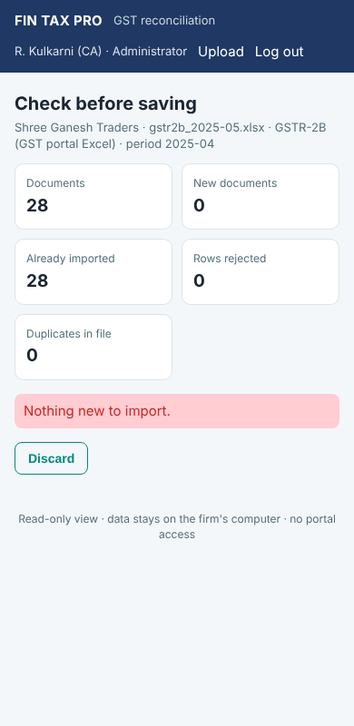

# Phase 5 – Table 8A, returns calendar, PostgreSQL, web uploads, signing

The specification lists three development phases and then the "second development
phase" modules, which became Phase 4. Phase 5 delivers the follow-up items listed in the
roadmap after Phase 4.

## 1. GSTR-9 Table 8A document details

The portal's *Table 8A document details* download (Excel or JSON) is imported as source
`gstr8a`:

```bash
fintax-gst import --client 1 --source gstr8a --file GSTR9_8A_2025-26.json
```

The desktop equivalent is *GSTR-3B & annual → GSTR-9 Table 8 → Import Table 8A…*.

* It is an annual statement, so no return period is asked for. Each document is filed
  under the month of its own date.
* B2B, B2BA, CDNR and CDNRA records are read. They go through the same validation,
  preview and repeated-import protection as every other import.

**Table 8 working.** When 8A documents exist for the year, **8A comes from them**, because
the portal is authoritative. The figure computed from the imported GSTR-2B periods is
still shown next to it, and the documents found on only one side are listed:

* in 8A but not in the imported GSTR-2B, typically invoices the supplier filed late;
* in the imported GSTR-2B but not in 8A.

Both lists are also sheets in the annual workbook (*8A Not in GSTR-2B*, *GSTR-2B Not in
8A*). Without a Table 8A import, 8A stays computed and the working says so.

**Books vs Table 8A reconciliation.** The same matching engine compares the whole year's
purchase register with Table 8A at document level:

```bash
fintax-gst reconcile --client 1 --fy 2025-26 --compare gstr8a --export reports/
```

The desktop equivalent is the *Reconcile books vs 8A* button. Categories, manual
decisions, exceptions and the workbook all work as usual, with "Table 8A" in place of
"GSTR-2B".


## 2. Returns calendar: monthly, QRMP and extensions

`compliance/calendar.py` works out what is due for each tax period from the client's
return frequency and state:

| Filer | Return | Due |
|---|---|---|
| Monthly | GSTR-1 | 11th of the next month |
| Monthly | GSTR-3B | 20th of the next month |
| QRMP, months 1–2 of a quarter | IFF (optional) | 13th of the next month |
| QRMP, months 1–2 of a quarter | PMT-06 | 25th of the next month |
| QRMP, quarter | GSTR-1 | 13th after the quarter |
| QRMP, quarter | GSTR-3B | 22nd (CG, MP, GJ, DD/DNH, MH, KA, GA, LD, KL, TN, PY, AN, TS, AP) or 24th (others) after the quarter |
| All | GSTR-9 / GSTR-9C | 31 December after the financial year |

**Extensions** are never assumed. A user with the settings permission records each
one with:

* the return, period and new date;
* the notification reference;
* optionally, the states it applies to.

The extended date then replaces the standard one everywhere and is marked as extended.

```bash
fintax-gst calendar extend --return GSTR-3B --period 2025-04 --due 2025-05-27 \
    --reference "Notification 9/2025-CT" --states 27,29
fintax-gst calendar                     # returns due in the next 30 days, plus up to 60 days overdue
fintax-gst calendar extensions
```

* **Upcoming returns** across all clients appear on the *Compliance → Returns calendar*
  tab, the web home page and the `calendar` command. For GSTR-3B and GSTR-1, each entry
  shows whether the return's data has been imported. Overdue entries are marked.
* **Month status** uses the calendar: a QRMP client is not flagged for a missing GSTR-3B
  in the first two months of a quarter, and an extended date appears in the issue text.
  The client compliance PDF and the dashboard workbook list the returns due in each
  month.

"Imported" means the GSTR-1 or GSTR-3B data is in FIN TAX PRO. It does not prove the
return was filed.


## 3. PostgreSQL

SQLite remains the default for the offline desktop. A firm that wants one shared database
for several computers, or for the web view, can use PostgreSQL:

```bash
pip install "psycopg[binary]"
set FINTAX_DB_URL=postgresql+psycopg://fintax@dbserver/fintax      (password: PGPASSWORD)
fintax-gst --login admin db-copy --to "postgresql+psycopg://fintax@dbserver/fintax"   # move a SQLite file
```

`--db` also accepts the URL, and the desktop app reads `FINTAX_DB_URL`.

* **Migrations** run on PostgreSQL as they do on SQLite. Evidence attachments, uploads
  and backups are kept in the data folder (`FINTAX_HOME`).
* **Backups of a server database** are consistent snapshots (one repeatable-read
  transaction) written as a SQLite file. Encrypted backups, automatic backups, retention
  and restore therefore work the same on both engines. A restore replaces all tables in
  one transaction and moves the id sequences past the restored rows.
* **`db-copy`** copies every table, ids included, into an empty database at the same
  schema version. It refuses a database that already holds clients.
* **Column lengths.** PostgreSQL enforces them and SQLite does not. Running the suite on
  PostgreSQL found long file paths being written to the audit log's 60-character
  reference column. The column now holds a shortened reference and the details keep the
  full one.
* **Secure delete.** PostgreSQL has no `secure_delete`. A client purge runs `VACUUM`, but
  the server's disk should be encrypted.

The whole test suite runs against PostgreSQL when a test database is given:

```bash
FINTAX_TEST_DB_URL="postgresql+psycopg://user@localhost/fintax_test" python -m pytest
```

Each test starts from an empty schema, so use a database created only for tests.

## 4. Uploads from the web view

Uploads are **off by default**. An administrator or manager turns them on with
*Sync & web → Allow file uploads* or `fintax-gst setting set web_uploads true`. Then a
user with the *import* permission sees **Upload** in the web header. The flow is:

1. Choose the client, the file type and the file. Allowed types:
   * purchase register or sales register;
   * GSTR-2B, GSTR-2A or GSTR-1;
   * IMS, GSTR-3B or Table 8A.

   Excel, CSV, JSON and ZIP files are accepted, up to 25 MB.
2. **Preview**: documents, new documents, documents already imported, rejected rows,
   duplicates, warnings and the first 50 rows that need attention. A file that was
   already imported, or that has nothing new, cannot be saved.
3. **Save** or **Discard**. Saving goes through the same import service as the desktop
   and is audited as "user (web)". The file is kept in the data folder as the import's
   source file.

Safeguards:

* Every form carries a CSRF token bound to the session.
* A preview can only be saved by the user who uploaded it, and it expires after 15
  minutes.
* A file whose headings aren't recognised is refused, with a pointer to the desktop
  mapping screen. Once the mapping is saved as a template, the next upload recognises
  the file.
* Nothing else on the web view changes data.



## 5. Signed Windows build

`packaging/build_windows.ps1` signs the two executables and the installer with
`signtool` when `FINTAX_SIGN_CERT` and `FINTAX_SIGN_PASSWORD` are set. It uses SHA-256
with an RFC 3161 timestamp and verifies each signature. See
[BUILD_WINDOWS.md](BUILD_WINDOWS.md). A code-signing certificate from a public CA is
required, and the Windows build itself has not been run in this environment.

## 6. Schema v5

| Change | Purpose |
|---|---|
| `due_date_overrides` | recorded due-date extensions (return, period, date, reference, states) |
| source type `GSTR8A` | Table 8A documents in `invoices` (no column change) |
| setting `web_uploads` | switches web uploads on (in `app_settings`) |
