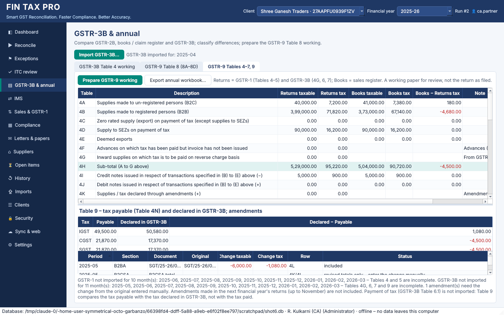

# Phase 6 – GSTR-9 working, column mapping on the web, verified Windows build

## 1. A fix that matters more than the features

`gst_recon/.gitignore` contained `reports/`. That rule meant to ignore report output, but
it also matched the **`fintax_gst/reports` package**, which holds the Excel, PDF, annual
and compliance reports. The package was therefore never committed. Every local test run
passed, but a fresh checkout could not import the application, and CI had failed on
every push since Phase 2 without anyone noticing.

* The rule is now anchored (`/reports/`) and the package is in the repository.
* The full suite was then run on a **fresh clone** of the committed tree.
* CI installs dependencies from `requirements.txt`, so a new dependency can't be left
  out of the workflow again.

## 2. GSTR-9 working (Tables 4, 5, 6, 7 and 9)

The annual workbook (`FINTAXPRO_GSTR9_Working_<GSTIN>_FY<year>.xlsx`) has Table 8 and three
new sheets: *GSTR-9 Tables 4-5*, *GSTR-9 Tables 6-7-9* and *GSTR-9 Amendments*.

* Desktop: *GSTR-3B & annual → GSTR-9 Tables 4–7, 9*
* CLI: `fintax-gst gstr9 --client 1 --fy 2025-26 [--out dir]`
* Web: the client page has a *GSTR-9 working* download.

| Table | Source | How |
|---|---|---|
| 4A | GSTR-1 B2CS + B2CL totals | |
| 4B, 4D, 4E, 5B, 5C | GSTR-1 B2B documents | classified per document: regular, SEZ with payment, deemed export, SEZ without payment, reverse charge |
| 4C, 5A | GSTR-1 EXP totals | with payment / without payment |
| 4I, 4J, 5H, 5I | GSTR-1 CDNR documents, CDNUR totals | credit / debit notes, taxable or zero-tax |
| 4K, 4L, 5J, 5K | B2BA / CDNRA | revised value − original value, when the original is in the imported GSTR-1 |
| 5D, 5E, 5F | GSTR-1 nil / exempt / non-GST totals | |
| 4F | – | GSTR-1 advance tables are not imported: shown as not available |
| 4G | GSTR-3B 3.1(d) | |
| 6A–6H, 7 | GSTR-3B Table 4 (4A1–4A5, 4D1, 4B1, 4B2) | combined where GSTR-3B does not split (inputs / capital goods / services; 6C vs 6D; reversal by rule) |
| 9 | Table 4N vs GSTR-3B 3.1(a)+(b)+(d) | tax payable vs tax declared; payments (GSTR-3B 6.1) are not imported |

* **Books column.** Every Table 4/5 row also shows the sales register, classified the same
  way, with the difference.
* **Amendments are never guessed.** An amendment whose original was not imported, and
  the summary-level amendment sections (B2CSA, B2CLA, EXPA, CDNURA), are listed with the
  revised values for manual entry.
* **Notes.** The working names the months for which GSTR-1 or GSTR-3B is missing, and
  states that amendments made in the next year's returns are not included.

Demo data includes a May 2025 GSTR-1 with:

* a B2BA reducing invoice SGT/25-26/0013 from ₹66,000 to ₹60,000, which appears in 4L;
* a B2CSA, which is listed for manual entry.

## 3. Column mapping in the web view

When an uploaded file's headings are not recognised, the web view now opens a mapping
form instead of referring the user to the desktop:

* one drop-down per field; amount fields accept several columns;
* required fields are checked;
* the mapping can be saved as a template.

The preview and confirmation then follow as usual.

**Saved templates are tried automatically** for files whose headings are not
recognised, newest first, for the same source type. This works in the desktop, the web
and the CLI. The preview notes which template was used. A layout therefore only needs
mapping once, wherever the user happens to be.

## 4. Windows build in CI

`.github/workflows/gst-recon.yml` now has three jobs:

* **test** on Ubuntu and Windows: the full suite and the demo.
* **postgres**: the full suite against a PostgreSQL 16 service.
* **windows-build**: runs `packaging\build_windows.ps1` on a Windows runner and uploads
  the executables and installer as the `FinTaxPro-windows` artifact. The script:
  1. creates the build environment;
  2. runs the tests;
  3. builds both PyInstaller executables;
  4. runs `FinTaxPro.exe --smoke-test` and the CLI demo;
  5. builds the Inno Setup installer;
  6. signs, if a certificate is configured.

The build script was corrected along the way:

* PowerShell does not wait for a windowed program, so the smoke test's exit code was
  never really checked. It now runs through `Start-Process -Wait`.
* Every native step (venv, PyInstaller, Inno Setup, CLI demo) now stops the build on
  failure.
* `FINTAX_BUILD_PYTHON` selects the interpreter when the `py` launcher is not
  available.

**Windows bug found by CI.** When the CLI's output was redirected (to a pipe, a log file
or CI), Windows used the cp1252 code page. It has no ₹ sign, so commands that print
amounts stopped with *'charmap' codec can't encode character*. Such streams are now
switched to UTF-8. A test reproduces the original failure.
