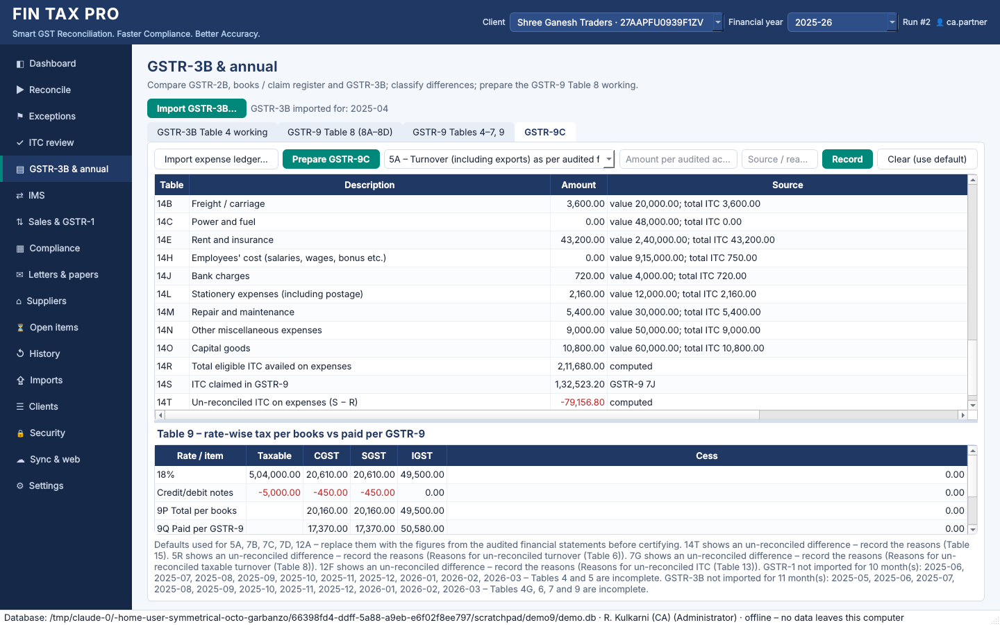

# Phase 8 – GSTR-9 Tables 10–14 and 17, GSTR-9C Table 14

## 1. GSTR-9 Tables 10 to 14 – this year's figures declared next year

The working now also reads the next year's GSTR-1 (April up to the cut-off, November by
default), and the claim register for the same months.

| Table | Content | How |
|---|---|---|
| 10 | Supplies / tax declared through amendments (+) | B2BA/CDNRA of the next year that raise a document of this year (revised − original), and this year's documents first reported in the next year's GSTR-1 |
| 11 | Supplies / tax reduced through amendments (−) | the same, where the value goes down; this year's credit notes reported next year |
| 12 | Reversal of ITC availed during the previous year | claim-register reversals in the next year for this year's documents |
| 13 | ITC availed for the previous year | claim-register claims in the next year for this year's documents (as Table 8C) |
| 14 | Differential tax on 10 and 11 | the tax payable on 10 − 11; the payment goes through the next year's GSTR-3B or DRC-03 and is not split out there |

* Documents behind Tables 10–13 are listed with their period, party, change and status.
* An amendment whose original document was not imported is listed for manual entry.
* **Amendments that belong to an earlier year are excluded.** A B2BA in this year's
  GSTR-1 whose original is dated in the previous year is marked *relates to FY … – its
  GSTR-9 Tables 10/11*. It no longer counts as missing an original in 4K/4L.

## 2. GSTR-9 Table 17 – HSN summary of outward supplies

GSTR-1 Table 12 (the HSN summary) is now imported, in both layouts: the single `data`
list, and the B2B / B2C split used from 2025. It is stored as `gstr1_hsn` (schema v7).

* Table 17 adds the year up by HSN, UQC and rate: quantity, taxable value and tax.
* **Consistency check.** The HSN total is compared with the GSTR-1 supplies by section.
  In the demo, the B2C sale left out of B2CS is in the HSN summary, so the check shows the
  ₹1,000 difference.
* Table 18 (inward HSN) is not prepared, because purchase registers rarely carry HSN.

## 3. GSTR-9C Table 14 – ITC availed on expenses

Table 14 lists, for each expense head, the value, the total ITC and the eligible ITC
availed:

| Row | Expense head |
|---|---|
| 14A | Purchases |
| 14B | Freight / carriage |
| 14C | Power and fuel |
| 14D | Imported material |
| 14E | Rent and insurance |
| 14F | Goods lost, stolen, written off or given as gifts / free samples |
| 14G | Royalties |
| 14H | Employees' cost |
| 14I | Conveyance |
| 14J | Bank charges |
| 14K | Entertainment |
| 14L | Stationery and postage |
| 14M | Repairs and maintenance |
| 14N | Other miscellaneous expenses |
| 14O | Capital goods |
| 14P | Any other expense 1 |
| 14Q | Any other expense 2 |

The totals rows:

* **14R** – total eligible ITC availed;
* **14S** – ITC claimed in GSTR-9 (7J);
* **14T** – the un-reconciled difference, *S − R*.

**Expense-ledger import.** Import a Tally Group Summary or any Excel/CSV with a ledger /
expense-head column, an amount column and ITC columns (eligible ITC defaults to total
ITC):

```bash
fintax-gst gstr9c import-expenses --client 1 --fy 2025-26 --file expense_ledger.csv --preview
fintax-gst gstr9c import-expenses --client 1 --fy 2025-26 --file expense_ledger.csv
```

The desktop equivalent is *GSTR-3B & annual → GSTR-9C → Import expense ledger…*. The
import works like this:

* Each head is placed in a row by keywords in its name. Repairs are checked before
  capital goods, so "Repairs to Machinery" goes to 14M and not 14O. Heads that match
  nothing go to 14N.
* The preview shows every head with its row; nothing is saved until you confirm.
* Saving replaces all the Table 14 figures. Rows that are no longer present are cleared,
  and every change is audited.
* Single figures can still be entered by hand: items `14A-V` (value), `14A-T` (total ITC)
  and `14A-E` (eligible ITC).
* A 14T difference with no reason recorded (R15) is flagged in the notes.



## 4. Schema v7

| Change | Purpose |
|---|---|
| `gstr1_hsn` | GSTR-1 Table 12 lines (HSN, description, UQC, rate, B2B/B2C, quantity, values) |

HSN lines are removed with their import, carried in sync packages, and deleted by a
client purge.
